# «Орбита» — как создавался цифровой деканат с ИИ

Конкурс «Цифровой деканат будущего». Описание процесса создания прототипа.

> Места с пометкой **[заполнить]** автор дописывает сам. Там нужны сведения, которых у ИИ-агента не было: опрос однокурсников, ссылка на развернутый сайт, видео.

## 1. Проблема и почему именно эти разделы

Учебная жизнь студента разбросана по разным местам. Расписание лежит на сайте, оценки в отдельной системе, справки выдают через очередь в деканате, объявления приходят в чаты и на почту. С телефона найти нужное трудно. Больше всего времени уходит на три вещи:

1. **«Куда мне сейчас идти?»** Утром студент открывает расписание и не знает, что пару перенесли: изменение было только в чате старосты.
2. **«Как у меня дела?»** Баллы видны, но непонятно, хватает ли их до допуска и что нужно на экзамене для «отлично».
3. **«Нужна справка».** Приходится идти в деканат в часы приема, стоять в очереди и возвращаться за готовой справкой через пару дней.

Поэтому кабинет построен вокруг главного экрана «Сегодня». Он сразу отвечает на эти вопросы: какая пара идет и какая следующая, что изменилось в расписании, какие дедлайны горят, в каком статусе заявки, нет ли риска по баллам и стипендии. Остальные разделы (Расписание, Учеба, Заявки, Лента) раскрывают каждый блок подробнее. До любой функции два касания.

**Что сказали однокурсники.** [заполнить: кого и сколько опросили, 3–5 главных выводов. Например: «7 из 10 узнают о переносах из чата», «справку об обучении заказывают 2–3 раза в год».]

### Идеи, которые меняют привычный опыт
| Было | Стало в «Орбите» |
| --- | --- |
| Очередь за справкой, 2 дня ожидания | Электронная справка с QR-кодом за секунды, подлинность проверяется на публичной странице |
| Очередь в деканат | Онлайн-запись на прием в свободный слот |
| О переносе пары пишут в чате | Изменение подсвечено в расписании, на главной и в ленте. Сотрудник вносит его в своем кабинете в два клика |
| «Сколько мне не хватает?» | Прогноз по текущему темпу, порог допуска и цели на экзамен для каждой оценки |
| Вопрос в деканат по почте без ответа | Переписка внутри заявки, у каждого шага есть статус и срок |
| Читать положения о стипендии | Прогноз стипендии и помощник «Спроси Орбиту» |

## 2. ИИ-инструменты, IDE и сервисы

| Инструмент | Для чего использован |
| --- | --- |
| **Claude Code** (Anthropic), облачная сессия в браузере | Основной ИИ-агент. Спроектировал архитектуру и схему базы, написал весь код сервера и интерфейса, придумал вымышленные данные, тексты интерфейса и CSS-дизайн-систему. Написал автотесты и сценарий браузерного прогона, нашел и исправил ошибки по скриншотам, подготовил README, CLAUDE.md и этот документ. |
| Навык (skill) Claude Code `claude-api` | Справочник актуального Claude API. Агент загрузил его перед тем, как писать помощника «Спроси Орбиту», чтобы использовать правильные параметры модели, effort и резервную модель при отказе. |
| **Claude API** (по желанию, ключ на сервере) | Работает внутри продукта: помощник отвечает на вопросы студента по его данным. |
| Playwright + Chromium | Не ИИ, а инструмент агента. Он прогоняет сценарии в браузере на ширине 360 px и 1440 px и снимает скриншоты, по которым агент сам находил ошибки верстки. |
| [заполнить] | Если для видео, логотипа или текстов использовались другие сервисы, перечислите их здесь. |

## 3. Как была поставлена задача ИИ-агенту

### 3.1 Исходный промпт
Агенту целиком дали текст положения конкурса: цели, обязательное ядро из 5 разделов, требования к прототипу, безопасности и тестовым аккаунтам, критерии оценки. Сам промпт короткий, всю конкретику задает документ с требованиями. Такой прием хорошо работает с агентами: требования не теряются при пересказе.

### 3.2 Как агент разложил задачу (этапы)
| Этап | Что сделано | Как проверено |
| --- | --- | --- |
| 1. Разведка | Агент изучил репозиторий и выделил прототипу отдельное место, позже проект переехал в собственный репозиторий `e-dekanat`. | `git status` |
| 2. Стек | Node.js + Express + встроенный SQLite, фронтенд на ES-модулях без сборки. Минимум зависимостей, быстрый запуск на любом хостинге. Шрифт и иконки взяты из открытых пакетов с подходящими лицензиями. | `npm install`, проверка `node:sqlite` |
| 3. Безопасность | scrypt для паролей, хеш токена сессии, AES-GCM для персональных полей, CSP, CSRF-заголовок, лимит попыток входа. | 14 автотестов |
| 4. Данные | Вымышленный вуз «Горизонт», 3 студента с разными ситуациями (отличница, студент с долгом, первокурсница) и сотрудник. Даты считаются от сегодняшнего дня, чтобы демо всегда выглядело живым. | curl по API |
| 5. API | Расписание с изменениями, расчет баллов и прогноза, каталог услуг со схемой форм, статусы и переписка, кабинет сотрудника. | curl + тесты |
| 6. Интерфейс | Дизайн-система (токены, светлая и темная тема), каркас: нижняя панель на телефоне, боковое меню на компьютере. 9 экранов студента и 3 экрана сотрудника. | Playwright, 360 и 1440 px |
| 7. Отладка по скриншотам | Агент смотрел скриншоты и правил верстку (см. раздел 5). | повторный прогон |
| 8. Документация | README, CLAUDE.md для агентов, этот документ. | — |

### 3.3 Ключевые решения, которые агент сформулировал для себя
- *«Личность берется только из сессии; чужой объект → 404, а не 403, чтобы не раскрывать его существование»*. Это правило записано в `CLAUDE.md`.
- *«Схема формы живет на сервере: фронтенд рисует форму по ней, сервер по ней же валидирует и отбрасывает лишние поля»*. Новая услуга добавляется одной записью в `catalog.js`.
- *«В ИИ уходит сводка без ФИО, контактов и номера зачетки»* (функция `contextText()` в `assistant.js`).
- *«Если ключа ИИ нет, помощник не ломается»*: он переключается на локальные правила, и жюри увидит работающий сценарий в любом случае.

### 3.4 Файлы для ИИ-агентов
- `CLAUDE.md` описывает стек, структуру, 8 непреложных правил безопасности и стиля, порядок проверки перед коммитом и рецепт «как добавить услугу». Следующий агент или человек продолжит работу без потери контекста.
- `test/security.test.js` служит исполняемой спецификацией безопасности. Если агент случайно нарушит разделение данных, тест упадет.
- `scripts/screenshots.js` — сквозной сценарий в браузере. Он одновременно проверяет работу и обновляет скриншоты для документации.

## 4. Скриншоты: от первой версии к готовому кабинету

Скриншоты лежат в `docs/screenshots/` и пересоздаются командой `npm run screenshots`.

**Вход и главный экран (телефон, 360 px)**

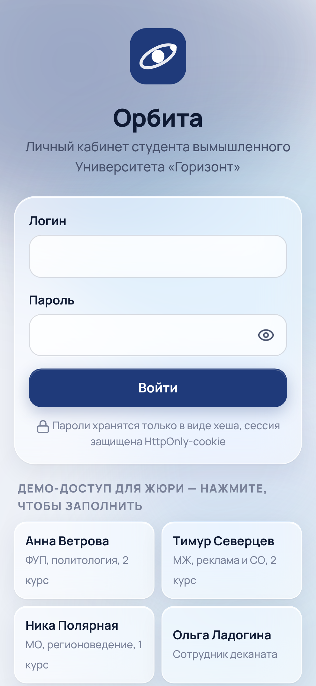 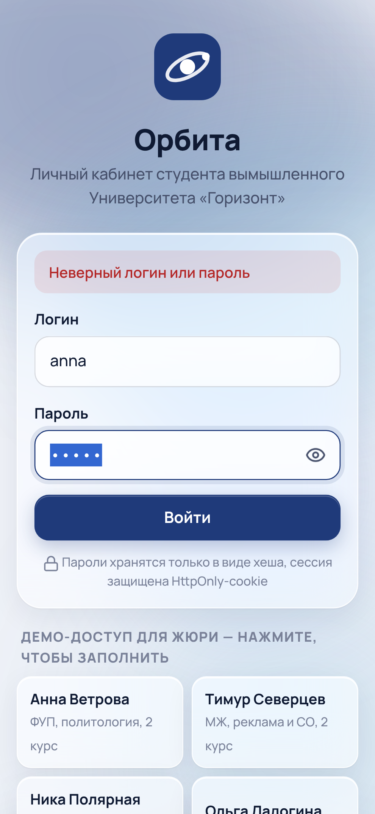 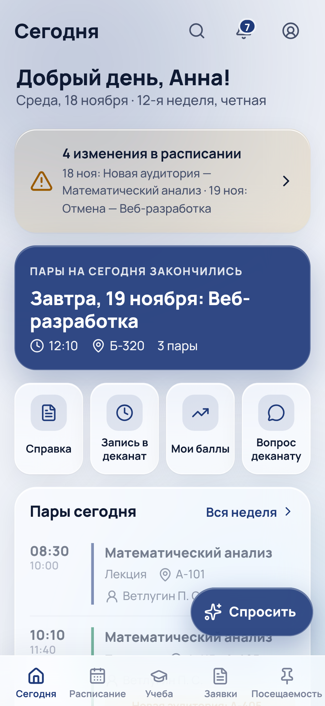

**Расписание с изменениями, успеваемость, сессия**

  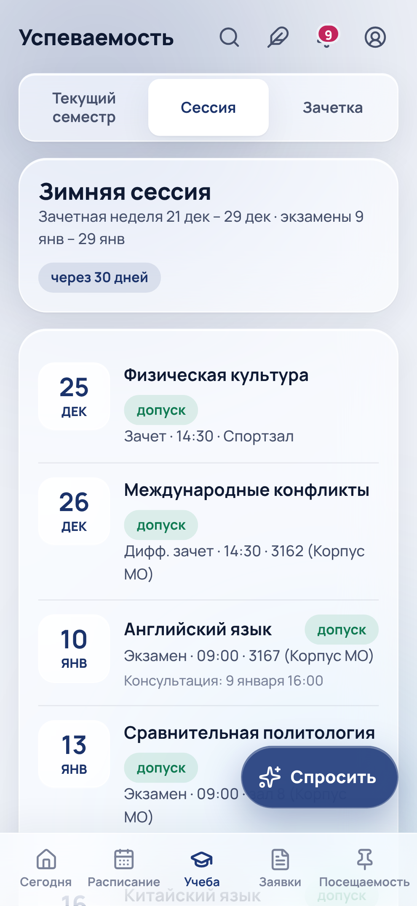

**Заявка: каталог → проверка формы → готово → карточка → справка с QR → проверка подлинности**

  

  

**Помощник, лента, профиль и безопасность**

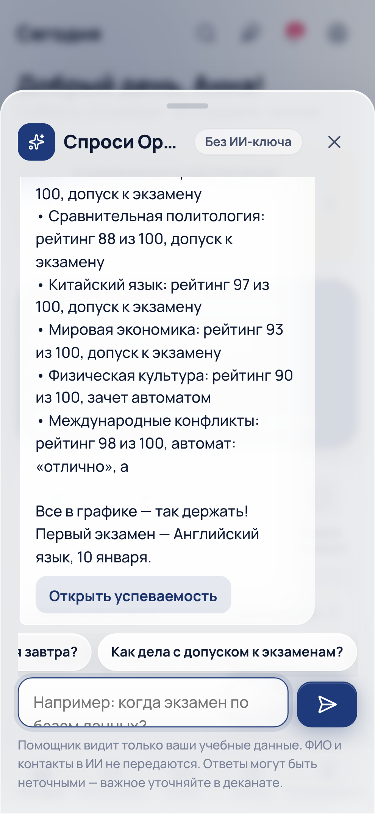 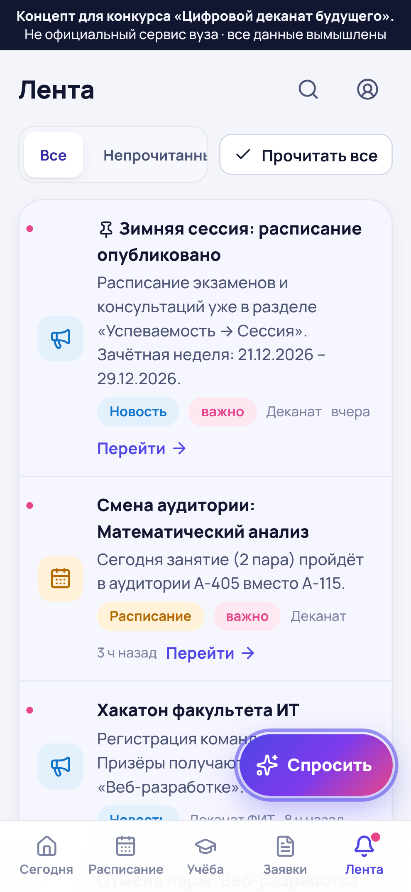 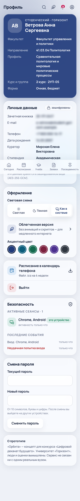

**Разные студенты видят разное: долг и переписка у Тимура, пустые состояния у Ники, попытка открыть чужую заявку**

 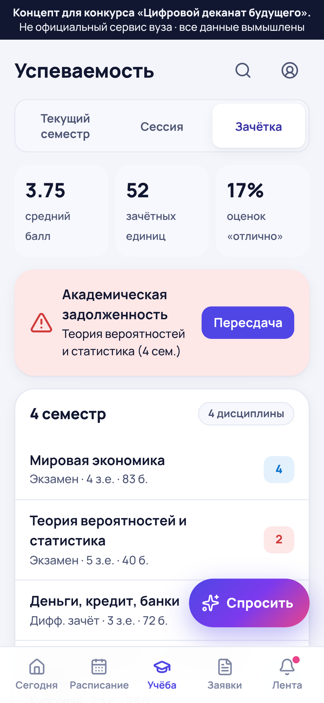 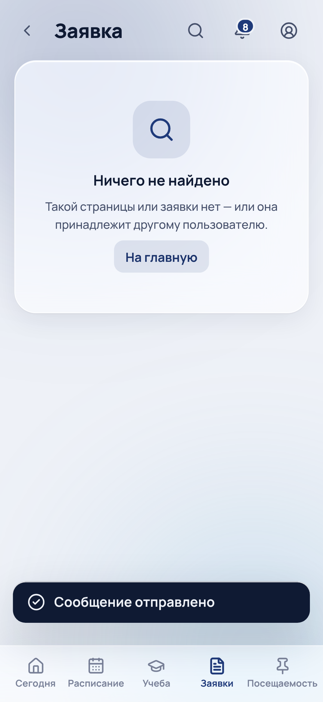

 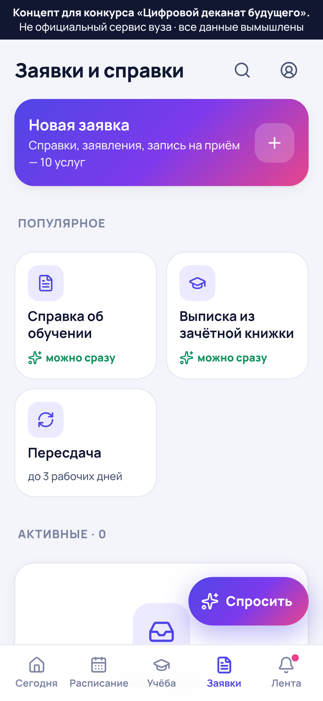

**Компьютер: главная, сетка недели, баллы, поиск Ctrl+K, темная тема**

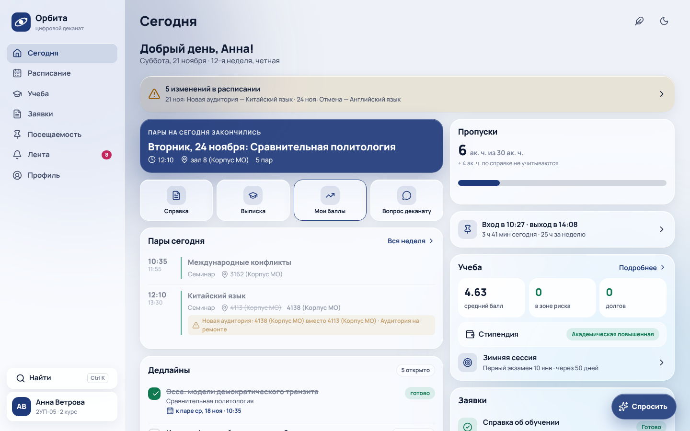

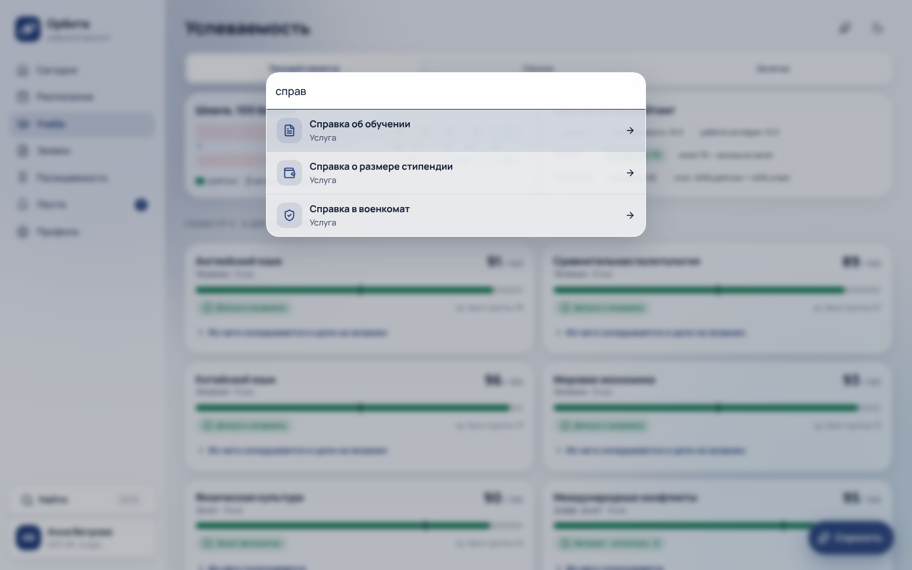
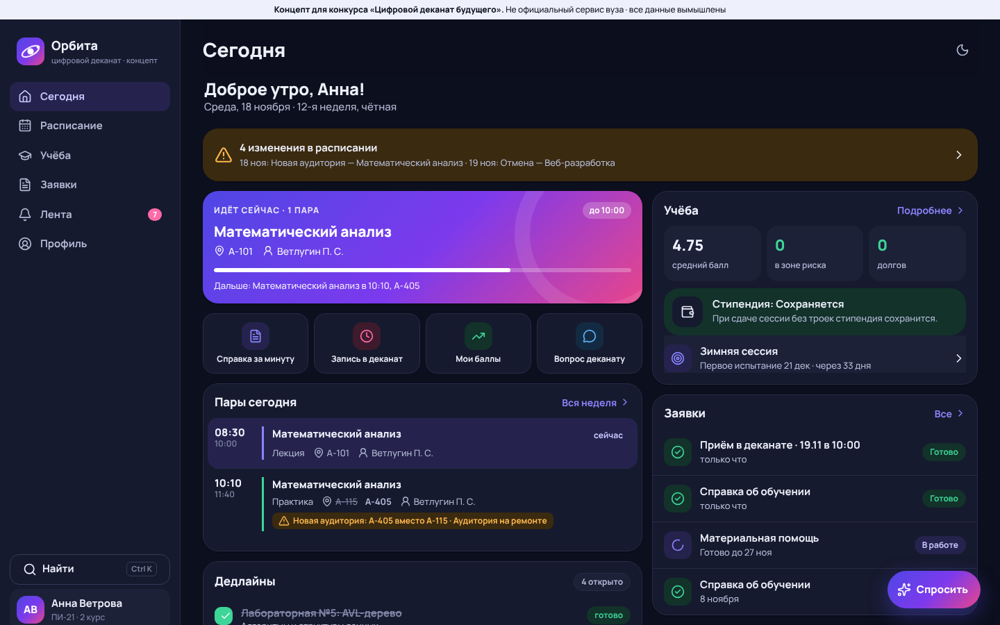

**Кабинет сотрудника деканата**

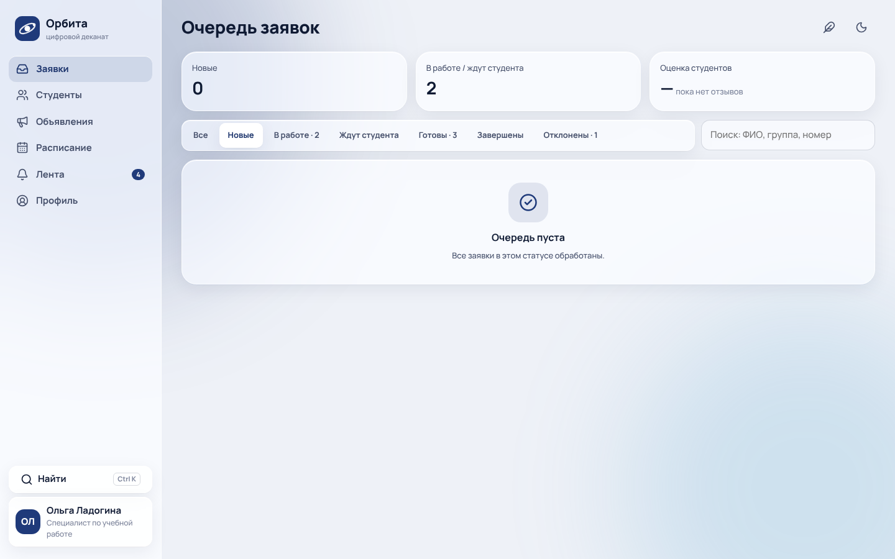

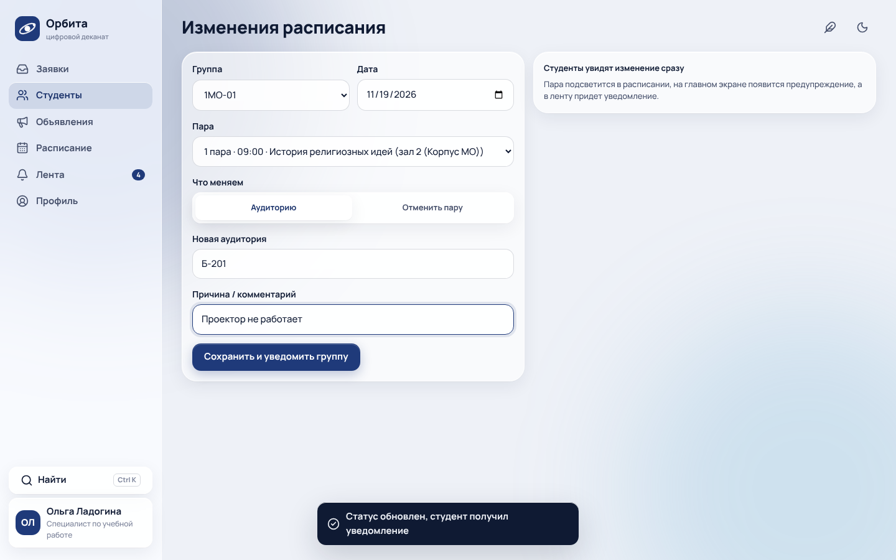

## 5. Ошибки ИИ и как они исправлялись

Агент не считал код готовым, пока не проверил его в браузере. Вот что нашлось и как было исправлено:

| Что пошло не так | Как обнаружено | Исправление |
| --- | --- | --- |
| Лента на телефоне шире экрана (587 px при ширине 360 px) | Автопроверка `scrollWidth` в Playwright | Элементы CSS-сетки по умолчанию не сжимаются; добавлено `min-width: 0` |
| На главной виден ненужный значок «Назад» | Скриншот главной | `display` у кнопки перебивал атрибут `hidden`; добавлено глобальное правило `[hidden]{display:none!important}` |
| Длинные заголовки уведомлений выходили за карточку | Скриншот | То же правило `min-width: 0` |
| Плавающая кнопка «Спросить» перекрывала кнопку отправки формы | Скриншот формы (ниже, «до») | На формах и в профиле кнопка скрывается |
| Дифф. зачет показывал «Сейчас: удовлетворительно» при 68 из 70 баллов | Ответ API через curl | Для дифф. зачета показывается прогнозная оценка, а не текущая |
| В справке «очная формы», «факультетаа» | Скриншот документа (ниже, «до») | Функция склонения названия факультета и формы обучения |
| Тесты мешали друг другу: блокировка после 5 неудачных входов отключала аккаунт для следующего теста | Падение `npm test` (429 вместо 200) | Тест блокировки перенесен в конец; добавлена проверка одинакового ответа для несуществующего логина |
| Командная оболочка отказалась выполнить длинную команду с созданием файлов | Отказ защитного механизма среды | Файлы созданы отдельными вызовами инструмента записи |

**До исправлений:**

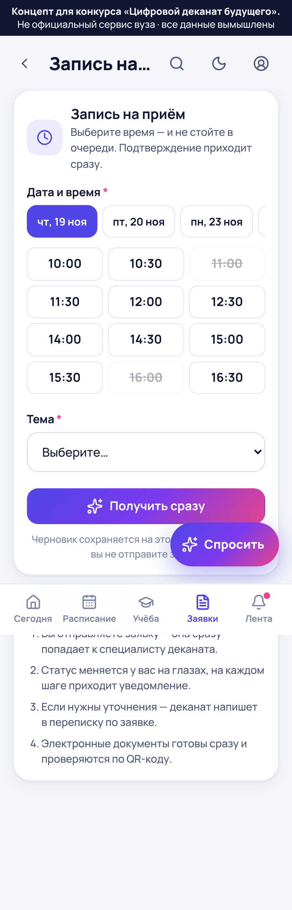 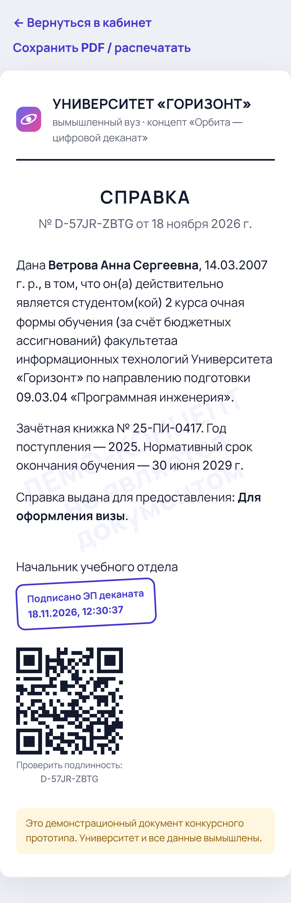

## 6. Как устроены вход, хранение данных и защита

- **Вход.** Студент вводит логин и пароль. На сервере пароль не хранится, хранится только его «отпечаток» (scrypt с солью). Подобрать пароль по отпечатку очень дорого. После 5 ошибок вход блокируется на 10 минут.
- **Сессия.** После входа браузер получает случайный «пропуск» в cookie. JavaScript его прочитать не может (HttpOnly), с чужого сайта он не отправится (SameSite и проверка заголовка). В базе лежит только отпечаток пропуска, поэтому украденная копия базы не дает войти.
- **Свои и чужие данные.** Сервер не верит номеру студента из адреса. Он всегда берет студента из сессии и ищет заявку с условием «эта заявка принадлежит этому студенту». Если подставить чужой номер, ответ будет «не найдено». Номера заявок случайные, их не угадать.
- **Персональные данные.** Телефон, e-mail, номер зачетки и дата рождения хранятся зашифрованными. Ключ задается в настройках сервера, а не в коде. В профиле эти поля скрыты, пока студент сам их не откроет.
- **ИИ.** Ключ Claude API лежит только в переменных окружения сервера, браузер его не видит. Помощник получает учебные данные без ФИО и контактов. На студента действует лимит 20 вопросов за 10 минут.
- **Сотрудник** видит заявки и минимум данных студента: ФИО, группу, курс. Все его действия записываются в журнал.
- **Проверено автотестами** (`npm test`): хеши паролей, шифрование полей, 401 без входа, 404 на чужую заявку и документ, 403 студенту в кабинете сотрудника, CSRF, блокировка перебора, сквозной сценарий справки и смены статуса.

## 7. Вторая итерация: правки автора после первого показа

После того как прототип развернули на Render, автор посмотрел его и дал агенту список правок одним сообщением:

> убери градиент, сделай дизайн типа liquid glass, акцент на элементах интерфейса должен быть цвета navy blue (по дефолту), световую схему можно выбрать… в блоке сессия нужно заменить слово «испытание» на слово «экзамен»… фразу «Баллов уже не хватит» тоже исключить, писать в нейтральном ключе… сделай легенду типа маленький квадратик со штриховкой — прогноз по вашему темпу, визуала больше там, где текст не обязателен… в заявках «пересдача» убрать, заменить на «ректорская пересдача», так как пересдачи у нас деканат и кафедра устанавливают самостоятельно… сделай рубрику «пропуски»: 30 академических часов — выговор, 60 — отчисление… сделай раздел, где будут входы и выходы из университета, типа СКУД… буквы ё убрать из всего текста.

Как агент это реализовал:

| Правка | Что сделано |
| --- | --- |
| Liquid glass, без градиентов, navy | Дизайн-токены переписаны: полупрозрачные панели с размытием (`backdrop-filter`), световой блик по верхней кромке, мягкие пятна фона. Все градиенты заменены сплошным акцентом `--accent` (navy `#1f3a7a`). Логотип и иконки перерисованы. |
| Выбор оформления | В профиле: световая схема (светлая / темная / как в системе) и 6 акцентных цветов, navy по умолчанию. Выбор запоминается на устройстве. |
| Нейтральные формулировки | «Баллов недостаточно», «Нужно еще N б.», чип «Внимание» вместо «Риск»; «Первый экзамен» вместо «Первое испытание». |
| Больше визуала | Текстовые пояснения заменены легендами-образцами (заливка, штриховка, отметка порога) и цветной шкалой оценок 0–55–70–85. |
| Пересдачи | Услуга «Пересдача» удалена, добавлена «Ректорская пересдача». Пересдачи назначает деканат (новая форма в кабинете сотрудника), они попадают в расписание студента, баннером на главную и уведомлением в ленту. |
| Пропуски | Новый блок на главной и раздел «Посещаемость»: пара = 2 ак. ч., шкала с порогами 30 ч (выговор) и 60 ч (отчисление), пропуски по справке не учитываются. |
| СКУД | Входы и выходы через турникеты: время внутри по дням (полоса дня 7:00–21:00), столбики за неделю, список проходов. Сотрудник видит таблицу студентов («сейчас внутри», часы за неделю, пропуски) и карточку каждого. |
| Буква «ё» | Заменена во всех текстах кода и документации (162 вхождения). |
| Пометка «концепт» | Баннер и подпись убраны. Короткая пометка «Демонстрационный прототип · данные вымышлены» оставлена на странице входа и водяным знаком на справках — этого требует положение конкурса. |

Добавлены 2 автотеста: студент видит только свои пропуски, проходы и пересдачи, а данные всех студентов доступны только деканату; обычной пересдачи в каталоге нет, ректорская есть.

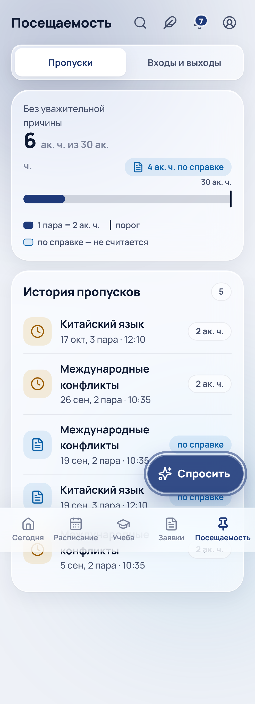 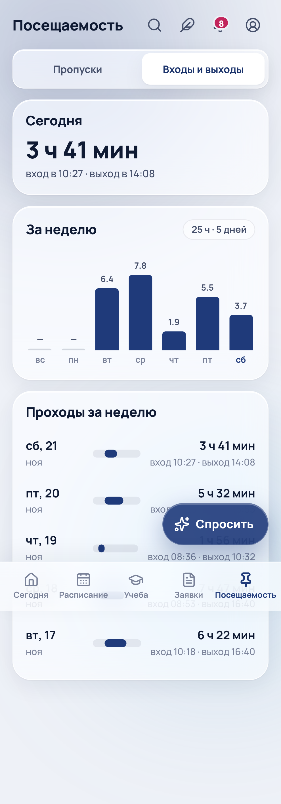 

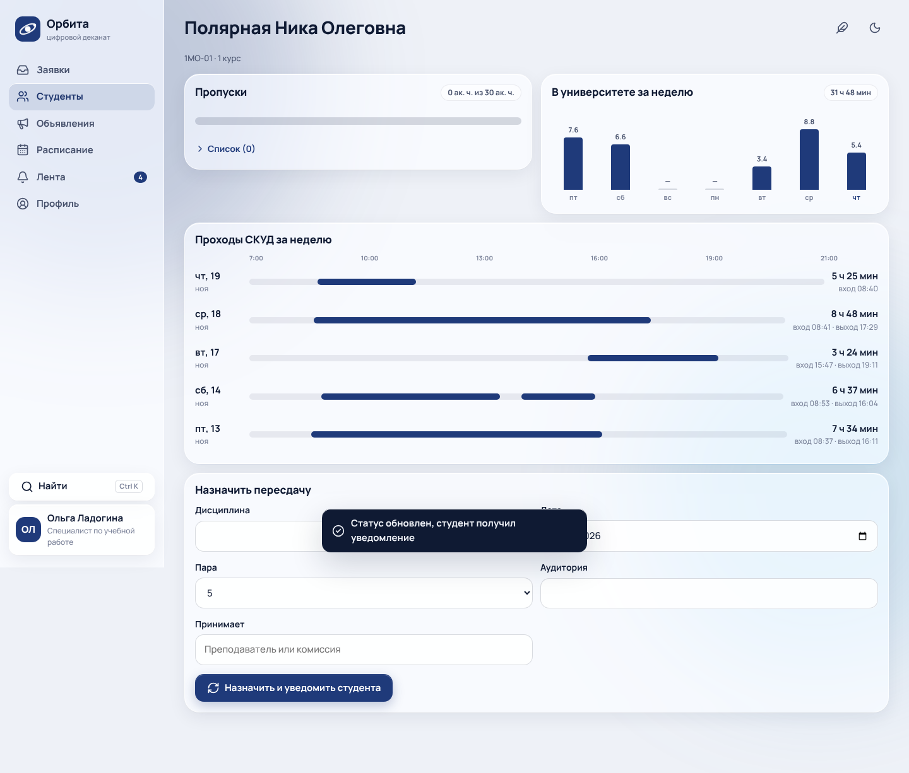

### Третья итерация

> «кампус» замени на «посещаемость»; если человек учится по договору, то не надо писать про стипендию; там есть странная линия под баннером; информационный блок «Весь деканат — в одном экране» убери совсем, вход поставь по центру, добавь анимацию liquid glass на фон, чтобы что-то медленно двигалось волнообразно; кнопку «в календарь» замени на «экспорт»; «справка за минуту» — на «справка»; логотип должен меняться в цвет выбранного акцента.

| Правка | Что сделано |
| --- | --- |
| «Посещаемость» | Раздел переименован в меню, заголовке, поиске и ответах помощника. |
| Стипендия по договору | Для обучающихся по договору блок стипендии не показывается нигде: ни на главной, ни в успеваемости, ни в профиле. Для бюджета — нейтрально: «Есть основания», «Пока нет оснований». |
| Линия под шапкой | Причина: у шапки был полупрозрачный фон, и его нижний край был виден на фоне. Теперь шапка прозрачна и получает «стекло» только при прокрутке. Декоративное кольцо на карточке «Сейчас» тоже убрано. |
| Вход | Информационный блок удален, форма по центру. На фоне медленно плывут размытые полупрозрачные волны (CSS-анимация 26–44 с, выключается при «уменьшить движение» в системе). |
| Кнопки | «Экспорт» в расписании, «Справка» на главной. |
| Логотип | Рисуется прямо в разметке и берет цвет из `--fill`, поэтому меняется вместе с акцентом; иконка вкладки браузера тоже. |

 

### Четвертая итерация: реалии вуза и облегченная версия

Автор прислал шкалу соответствия оценок, таблицу времени пар, список факультетов и три текстовых файла с расписанием групп, а также попросил кнопку облегченной версии на случай, если сайт висит.

| Правка | Что сделано |
| --- | --- |
| Расписание из файлов | Агент написал разборщик: определил дни по порядку пар и меткам «пт»/«сб», оставил общую группу, поток и одну языковую подгруппу, убрал ФИО преподавателей, переименовал физкультуру. Получилось `server/schedule-data.js` для групп 2УП-05 (ФУП, 2 курс), 1МО-01 (МО, 1 курс), 2МЖ-05 (МЖ, 2 курс). |
| Время пар | Две сетки: МО, ФУП, МЖ — обед после 3-й пары; МЭО, МП, МБ, ИМТУР — после 2-й. Восемь пар до 21:50. |
| Шкала оценок | Рейтинг в процентах → 5-балльная оценка и ECTS (A–F). Зачет с 60 баллов. В зачетке и выписке рядом с оценкой стоят баллы и буква ECTS. |
| Факультеты | Демо-студенты переведены на ФУП (политология), МЖ (реклама и связи с общественностью) и МО (зарубежное регионоведение); справочник всех факультетов — в `academic.js`. |
| Облегченная версия | `/lite`: серверные страницы без скриптов, анимаций и шрифтов (сегодня, расписание, учеба, заявки, посещаемость, лента). Вход формой, защита от подделки форм по Origin. Предложение перейти появляется автоматически при медленной загрузке; постоянная кнопка — в шапке рядом со сменой темы. |
| «можно сразу» | Везде просто «сразу». |

Добавлены тесты: облегченная версия не пускает без входа, не показывает чужую заявку и отклоняет форму с чужого сайта; шкала оценок дает правильные буквы ECTS; время 3-й пары зависит от факультета.

 

### Пятая итерация: правила рейтинга и посещаемости

| Правка | Что сделано |
| --- | --- |
| Демо-доступ | Подписи карточек входа приведены к новым факультетам. |
| СКУД | Вместо «внутри с …» — «вход в …» и «выход в …». |
| Рейтинг | Вместо контрольных точек — «Срез 1/2/3», «Посещаемость» (% посещенных пар, считается по расписанию и пропускам) и «Работа на парах». Веса: срезы 1, посещаемость 0,5, работа на парах 0,3. Срез 1 заполнен, срезы 2–3 впереди. |
| Зачет | От 70 баллов — автомат, ниже — выход на зачет. |
| Цвета расписания | Пересдача отделена от изменений и выделена красным. Найдена причина невидимого цвета лекций: «стеклянная» рамка перекрывала левую полосу, а для лекций не было отдельного правила. Цвета всех видов занятий заданы явно. |
| Пропуски | «6 ак. ч. из 30 ак. ч.»; после 30 ак. ч. — «36 ак. ч. из 60 ак. ч.» красным с пометкой «риск отчисления». |

### Шестая итерация

| Правка | Что сделано |
| --- | --- |
| Пары от деканата | Сотрудник ставит занятие на любое время (начало, конец, дисциплина, вид, аудитория). Если время пересекается с одной или несколькими парами группы, форма показывает ошибку с перечнем пересечений, и занятие не сохраняется. Группа получает уведомление. |
| Шкала пропусков | Убрана лишняя вертикальная отметка в конце шкалы. |
| Правила рейтинга | «Автомат от 70» вынесен в строку «Зачет», допуск и формула — в строку «Экзамен». |
| Карточки дисциплин | «ср. балл группы» вместо «группа», прогноз убран. |
| Выравнивание | Заголовок страницы на широком экране выровнен по левому краю блоков; подзаголовки разделов — тоже. |

### Седьмая итерация: мероприятия, задания к парам, кабинет преподавателя, PDF-заявления

Автор надиктовал большой список правок голосом; агент разобрал его на задачи:

| Правка | Что сделано |
| --- | --- |
| Метка «важно» | В темной теме текст метки сливался с фоном: переменная акцентного цвета после редизайна стала navy. Розовый цвет вынесен в отдельную переменную, метка читается в обеих темах. |
| Мероприятия | Таблицы `events` и `user_events`. В ленте — карточка мероприятия с кнопками «Добавить в календарь» и «Подробнее», отдельная страница с описанием и файлом .ics. При пересечении с парами — окно «Пересечение с расписанием» со списком пар и кнопкой «Все равно добавить». Создавать мероприятия могут деканат и преподаватель. |
| Пересечения в расписании | Пересекающиеся события объединяются в блок «Пересечение по времени» и встают стопкой со сдвигом. Первая версия ставила их в колонки — на телефоне текст наезжал (скриншот прогона это показал), поэтому выбран вариант со сдвигом. |
| Задания и дедлайны | Дедлайн может быть привязан к паре (`lesson_date`, `lesson_start`) или быть самостоятельным. Пары кликабельны: карточка пары показывает задания; на главной у дедлайна ссылка «к паре …». |
| Кабинет преподавателя | Роль `teacher`, вымышленный преподаватель «Мировой экономики». Расписание по группам, отметка посещаемости (сразу меняет пропуски и рейтинг), задания с дедлайнами, сводка посещаемости, мероприятия, заявки на перенос с проверкой пересечений. |
| Перенос через деканат | Заявка преподавателя падает в «Расписание» деканата; после одобрения у студентов появляется перенос, преподавателю приходит уведомление; отказ — только с причиной. |
| Услуги | Убраны запись на прием, справка в военкомат и индивидуальный график (его нет в вузе). Осталось 7 услуг. Пример «деканат ждет ответа» — академический отпуск с запросом документов. |
| PDF-заявления | Для заявлений (материальная помощь, академический отпуск, ректорская пересдача) — типовое заявление в PDF: шапка справа, текст по данным заявки, строки для дописывания, дата и подпись. Есть и пустой бланк. |

Тесты (20): мероприятие с пересечением требует подтверждения и появляется в расписании; мероприятие другого факультета не открывается; преподаватель не может отметить чужую пару; задание появляется у студента в дедлайнах и в карточке пары; перенос одобряется деканатом и виден группе; PDF-заявление можно получить только по своей заявке.

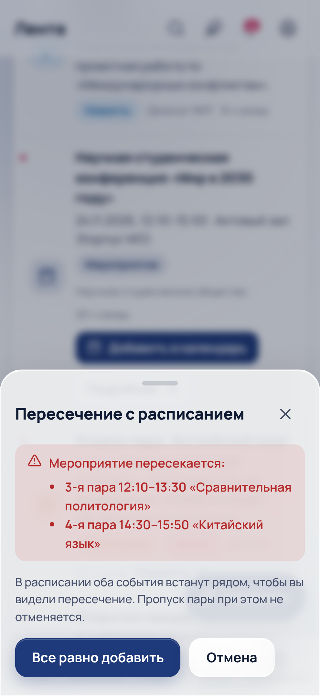 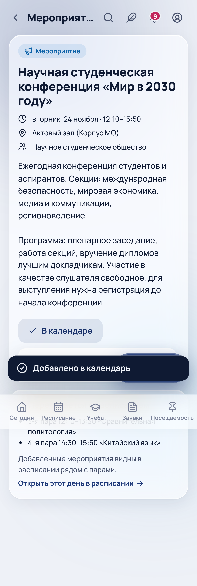 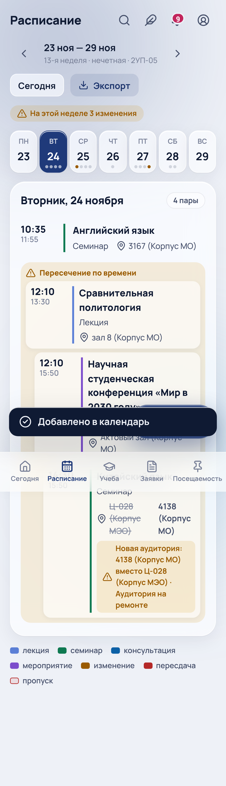

### Восьмая итерация

| Правка | Что сделано |
| --- | --- |
| Значок о переносах | У деканата на пункте «Расписание» и у преподавателя на «Переносах» — счетчик заявок, ждущих решения. В расписании преподавателя пара с такой заявкой помечена «перенос на согласовании». |
| Облегченная версия работает с заявками | Студент подает заявку по той же схеме формы, отвечает на уточнение, отзывает заявку, скачивает PDF-заявление. Деканат меняет статус (с обязательной причиной для уточнения и отказа), пишет студенту, согласует переносы пар. Преподаватель отмечает посещаемость и просит перенос. Логика вынесена в общий модуль `server/workflows.js` — полная и облегченная версии работают одинаково. |
| Тексты и легенды | Убрана подпись внизу облегченной версии, легенда под шкалой пропусков, пояснения в блоке «Пороги» (остались «автомат от 70 баллов» и «допуск к экзамену от 50 баллов»); «Сегодня проходов в университет не было». |
| Кнопки-иконки | Круглые, без квадратной подсветки при наведении. |

 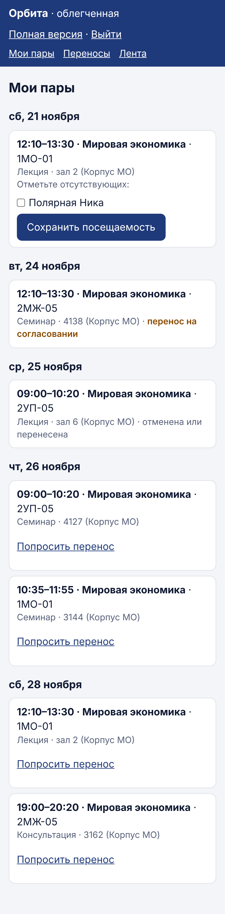

## 8. Что сделано вручную
- [заполнить] Опрос однокурсников.
- [заполнить] Развертывание на хостинге и проверка ссылки с телефона.
- [заполнить] Запись видео-демонстрации.
- [заполнить] Ревью кода и текстов, правки по своему вкусу.
- Название «Орбита», вымышленный университет «Горизонт» и тестовых персонажей предложил агент. [заполнить: что вы оставили, а что изменили]
