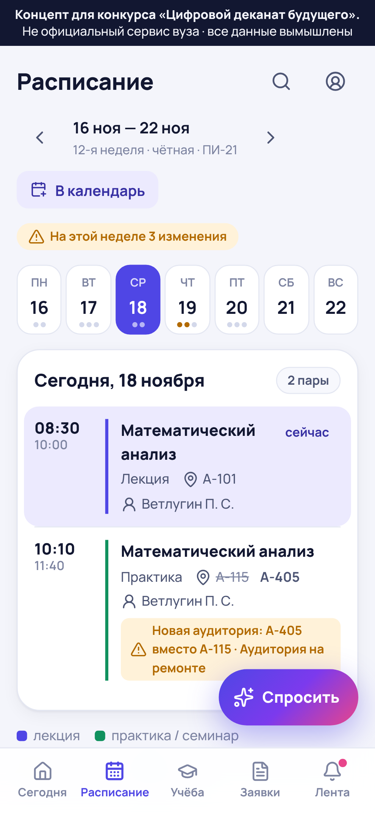
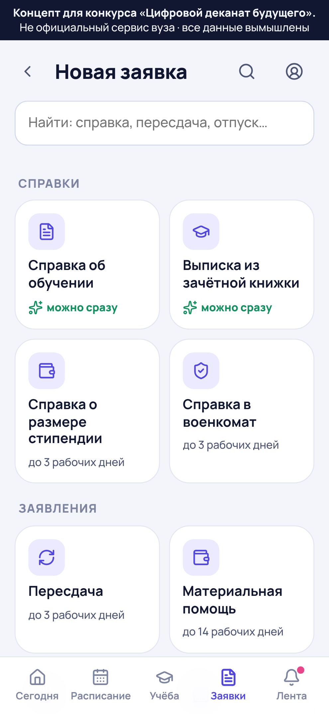
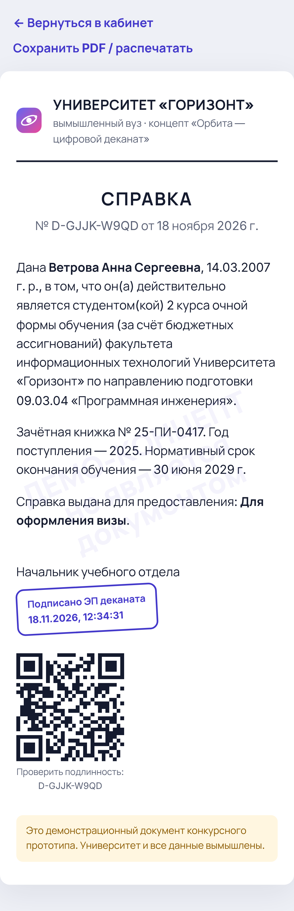
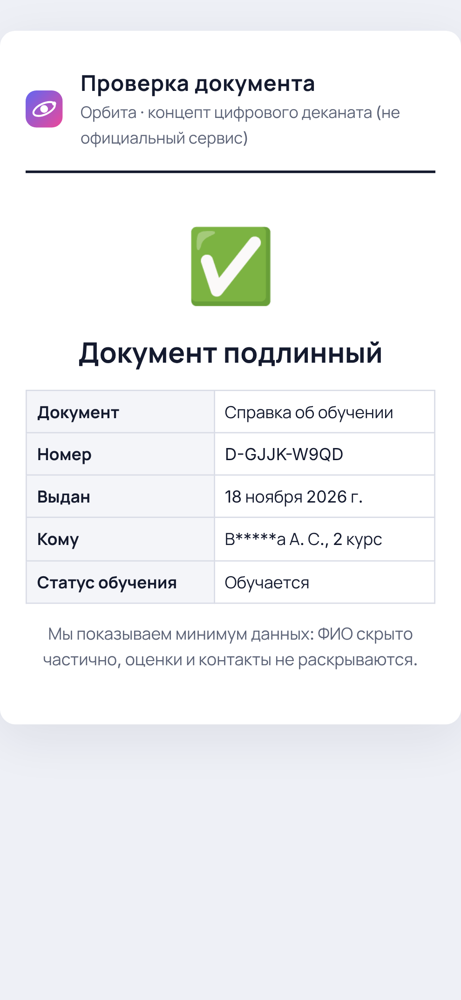
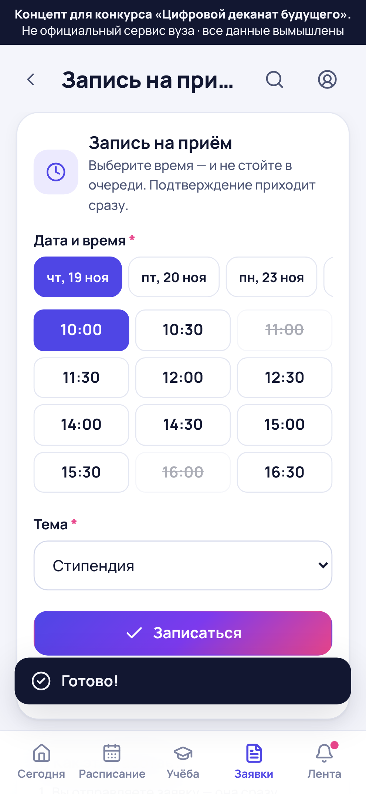
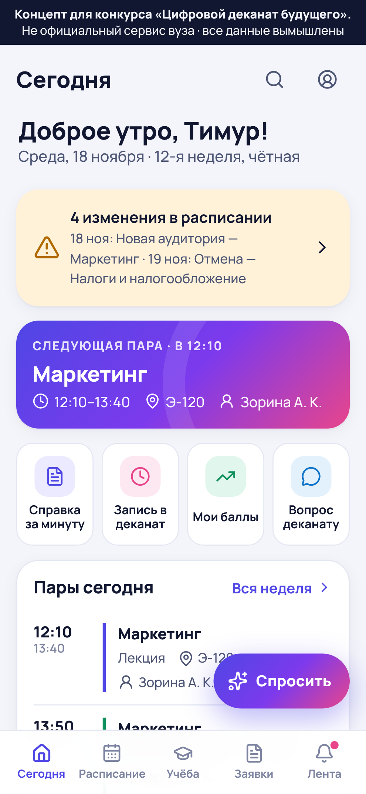
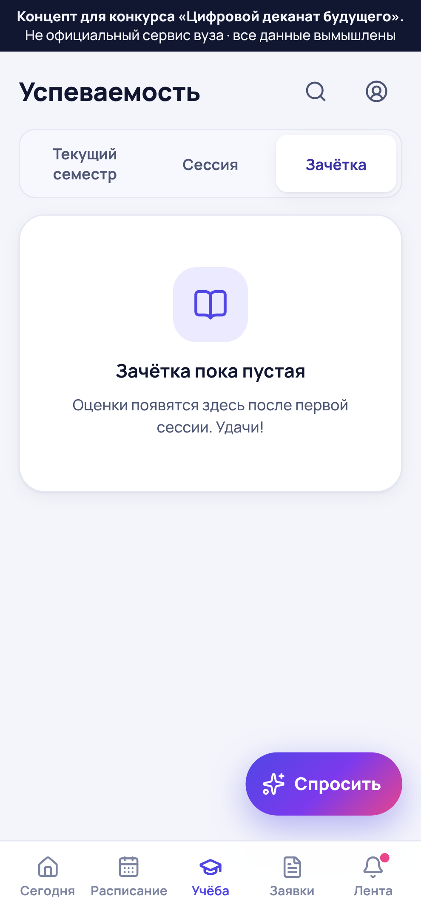

# «Орбита» — как создавался цифровой деканат с ИИ

Конкурс «Цифровой деканат будущего». Описание процесса создания прототипа.

> Места с пометкой **[заполнить]** автор дописывает сам. Там нужны сведения, которых у ИИ-агента не было: опрос однокурсников, ссылка на развёрнутый сайт, видео.

## 1. Проблема и почему именно эти разделы

Учебная жизнь студента разбросана по разным местам. Расписание лежит на сайте, оценки в отдельной системе, справки выдают через очередь в деканате, объявления приходят в чаты и на почту. С телефона найти нужное трудно. Больше всего времени уходит на три вещи:

1. **«Куда мне сейчас идти?»** Утром студент открывает расписание и не знает, что пару перенесли: изменение было только в чате старосты.
2. **«Как у меня дела?»** Баллы видны, но непонятно, хватает ли их до допуска и что нужно на экзамене для «отлично».
3. **«Нужна справка».** Приходится идти в деканат в часы приёма, стоять в очереди и возвращаться за готовой справкой через пару дней.

Поэтому кабинет построен вокруг главного экрана «Сегодня». Он сразу отвечает на эти вопросы: какая пара идёт и какая следующая, что изменилось в расписании, какие дедлайны горят, в каком статусе заявки, нет ли риска по баллам и стипендии. Остальные разделы (Расписание, Учёба, Заявки, Лента) раскрывают каждый блок подробнее. До любой функции два касания.

**Что сказали однокурсники.** [заполнить: кого и сколько опросили, 3–5 главных выводов. Например: «7 из 10 узнают о переносах из чата», «справку об обучении заказывают 2–3 раза в год».]

### Идеи, которые меняют привычный опыт
| Было | Стало в «Орбите» |
| --- | --- |
| Очередь за справкой, 2 дня ожидания | Электронная справка с QR-кодом за секунды, подлинность проверяется на публичной странице |
| Очередь в деканат | Онлайн-запись на приём в свободный слот |
| О переносе пары пишут в чате | Изменение подсвечено в расписании, на главной и в ленте. Сотрудник вносит его в своём кабинете в два клика |
| «Сколько мне не хватает?» | Прогноз по текущему темпу, порог допуска и цели на экзамен для каждой оценки |
| Вопрос в деканат по почте без ответа | Переписка внутри заявки, у каждого шага есть статус и срок |
| Читать положения о стипендии | Прогноз стипендии и помощник «Спроси Орбиту» |

## 2. ИИ-инструменты, IDE и сервисы

| Инструмент | Для чего использован |
| --- | --- |
| **Claude Code** (Anthropic), облачная сессия в браузере | Основной ИИ-агент. Спроектировал архитектуру и схему базы, написал весь код сервера и интерфейса, придумал вымышленные данные, тексты интерфейса и CSS-дизайн-систему. Написал автотесты и сценарий браузерного прогона, нашёл и исправил ошибки по скриншотам, подготовил README, CLAUDE.md и этот документ. |
| Навык (skill) Claude Code `claude-api` | Справочник актуального Claude API. Агент загрузил его перед тем, как писать помощника «Спроси Орбиту», чтобы использовать правильные параметры модели, effort и резервную модель при отказе. |
| **Claude API** (по желанию, ключ на сервере) | Работает внутри продукта: помощник отвечает на вопросы студента по его данным. |
| Playwright + Chromium | Не ИИ, а инструмент агента. Он прогоняет сценарии в браузере на ширине 360 px и 1440 px и снимает скриншоты, по которым агент сам находил ошибки вёрстки. |
| [заполнить] | Если для видео, логотипа или текстов использовались другие сервисы, перечислите их здесь. |

## 3. Как была поставлена задача ИИ-агенту

### 3.1 Исходный промпт
Агенту целиком дали текст положения конкурса: цели, обязательное ядро из 5 разделов, требования к прототипу, безопасности и тестовым аккаунтам, критерии оценки. Сам промпт короткий, всю конкретику задаёт документ с требованиями. Такой приём хорошо работает с агентами: требования не теряются при пересказе.

### 3.2 Как агент разложил задачу (этапы)
| Этап | Что сделано | Как проверено |
| --- | --- | --- |
| 1. Разведка | Агент изучил репозиторий и выделил прототипу отдельное место, позже проект переехал в собственный репозиторий `e-dekanat`. | `git status` |
| 2. Стек | Node.js + Express + встроенный SQLite, фронтенд на ES-модулях без сборки. Минимум зависимостей, быстрый запуск на любом хостинге. Шрифт и иконки взяты из открытых пакетов с подходящими лицензиями. | `npm install`, проверка `node:sqlite` |
| 3. Безопасность | scrypt для паролей, хеш токена сессии, AES-GCM для персональных полей, CSP, CSRF-заголовок, лимит попыток входа. | 12 автотестов |
| 4. Данные | Вымышленный вуз «Горизонт», 3 студента с разными ситуациями (отличница, студент с долгом, первокурсница) и сотрудник. Даты считаются от сегодняшнего дня, чтобы демо всегда выглядело живым. | curl по API |
| 5. API | Расписание с изменениями, расчёт баллов и прогноза, каталог услуг со схемой форм, статусы и переписка, кабинет сотрудника. | curl + тесты |
| 6. Интерфейс | Дизайн-система (токены, светлая и тёмная тема), каркас: нижняя панель на телефоне, боковое меню на компьютере. 9 экранов студента и 3 экрана сотрудника. | Playwright, 360 и 1440 px |
| 7. Отладка по скриншотам | Агент смотрел скриншоты и правил вёрстку (см. раздел 5). | повторный прогон |
| 8. Документация | README, CLAUDE.md для агентов, этот документ. | — |

### 3.3 Ключевые решения, которые агент сформулировал для себя
- *«Личность берётся только из сессии; чужой объект → 404, а не 403, чтобы не раскрывать его существование»*. Это правило записано в `CLAUDE.md`.
- *«Схема формы живёт на сервере: фронтенд рисует форму по ней, сервер по ней же валидирует и отбрасывает лишние поля»*. Новая услуга добавляется одной записью в `catalog.js`.
- *«В ИИ уходит сводка без ФИО, контактов и номера зачётки»* (функция `contextText()` в `assistant.js`).
- *«Если ключа ИИ нет, помощник не ломается»*: он переключается на локальные правила, и жюри увидит работающий сценарий в любом случае.

### 3.4 Файлы для ИИ-агентов
- `CLAUDE.md` описывает стек, структуру, 8 непреложных правил безопасности и стиля, порядок проверки перед коммитом и рецепт «как добавить услугу». Следующий агент или человек продолжит работу без потери контекста.
- `test/security.test.js` служит исполняемой спецификацией безопасности. Если агент случайно нарушит разделение данных, тест упадёт.
- `scripts/screenshots.js` — сквозной сценарий в браузере. Он одновременно проверяет работу и обновляет скриншоты для документации.

## 4. Скриншоты: от первой версии к готовому кабинету

Скриншоты лежат в `docs/screenshots/` и пересоздаются командой `npm run screenshots`.

**Вход и главный экран (телефон, 360 px)**

  

**Расписание с изменениями, успеваемость, сессия**

  

**Заявка: каталог → проверка формы → готово → карточка → справка с QR → проверка подлинности**

  

  

**Помощник, лента, профиль и безопасность**

  

**Разные студенты видят разное: долг и переписка у Тимура, пустые состояния у Ники, попытка открыть чужую заявку**

  

 

**Компьютер: главная, сетка недели, баллы, поиск Ctrl+K, тёмная тема**

**Кабинет сотрудника деканата**

## 5. Ошибки ИИ и как они исправлялись

Агент не считал код готовым, пока не проверил его в браузере. Вот что нашлось и как было исправлено:

| Что пошло не так | Как обнаружено | Исправление |
| --- | --- | --- |
| Лента на телефоне шире экрана (587 px при ширине 360 px) | Автопроверка `scrollWidth` в Playwright | Элементы CSS-сетки по умолчанию не сжимаются; добавлено `min-width: 0` |
| На главной виден ненужный значок «Назад» | Скриншот главной | `display` у кнопки перебивал атрибут `hidden`; добавлено глобальное правило `[hidden]{display:none!important}` |
| Длинные заголовки уведомлений выходили за карточку | Скриншот | То же правило `min-width: 0` |
| Плавающая кнопка «Спросить» перекрывала кнопку отправки формы | Скриншот формы (ниже, «до») | На формах и в профиле кнопка скрывается |
| Дифф. зачёт показывал «Сейчас: удовлетворительно» при 68 из 70 баллов | Ответ API через curl | Для дифф. зачёта показывается прогнозная оценка, а не текущая |
| В справке «очная формы», «факультетаа» | Скриншот документа (ниже, «до») | Функция склонения названия факультета и формы обучения |
| Тесты мешали друг другу: блокировка после 5 неудачных входов отключала аккаунт для следующего теста | Падение `npm test` (429 вместо 200) | Тест блокировки перенесён в конец; добавлена проверка одинакового ответа для несуществующего логина |
| Командная оболочка отказалась выполнить длинную команду с созданием файлов | Отказ защитного механизма среды | Файлы созданы отдельными вызовами инструмента записи |

**До исправлений:**

 

## 6. Как устроены вход, хранение данных и защита

- **Вход.** Студент вводит логин и пароль. На сервере пароль не хранится, хранится только его «отпечаток» (scrypt с солью). Подобрать пароль по отпечатку очень дорого. После 5 ошибок вход блокируется на 10 минут.
- **Сессия.** После входа браузер получает случайный «пропуск» в cookie. JavaScript его прочитать не может (HttpOnly), с чужого сайта он не отправится (SameSite и проверка заголовка). В базе лежит только отпечаток пропуска, поэтому украденная копия базы не даёт войти.
- **Свои и чужие данные.** Сервер не верит номеру студента из адреса. Он всегда берёт студента из сессии и ищет заявку с условием «эта заявка принадлежит этому студенту». Если подставить чужой номер, ответ будет «не найдено». Номера заявок случайные, их не угадать.
- **Персональные данные.** Телефон, e-mail, номер зачётки и дата рождения хранятся зашифрованными. Ключ задаётся в настройках сервера, а не в коде. В профиле эти поля скрыты, пока студент сам их не откроет.
- **ИИ.** Ключ Claude API лежит только в переменных окружения сервера, браузер его не видит. Помощник получает учебные данные без ФИО и контактов. На студента действует лимит 20 вопросов за 10 минут.
- **Сотрудник** видит заявки и минимум данных студента: ФИО, группу, курс. Все его действия записываются в журнал.
- **Проверено автотестами** (`npm test`): хеши паролей, шифрование полей, 401 без входа, 404 на чужую заявку и документ, 403 студенту в кабинете сотрудника, CSRF, блокировка перебора, сквозной сценарий справки и смены статуса.

## 7. Что сделано вручную
- [заполнить] Опрос однокурсников.
- [заполнить] Развёртывание на хостинге и проверка ссылки с телефона.
- [заполнить] Запись видео-демонстрации.
- [заполнить] Ревью кода и текстов, правки по своему вкусу.
- Название «Орбита», вымышленный университет «Горизонт» и тестовых персонажей предложил агент. [заполнить: что вы оставили, а что изменили]
