# «Орбита» — цифровой деканат будущего

**Описание процесса создания прототипа.** Конкурс «Цифровой деканат будущего», ноябрь 2026.

| | |
| --- | --- |
| **Прототип** | https://orbita-gorizont.duckdns.org (запасной адрес: https://109.120.152.121) |
| **Исходный код** | https://github.com/jeenien/e-dekanat |
| **Тестовые аккаунты** | см. раздел 2 |
| **Кто делал** | Автор ставил задачи, проверял результат и принимал решения. Код, тексты интерфейса, дизайн и документацию писал ИИ-агент Claude Code |
| **Сроки** | 18–22 ноября 2026: первая версия и 16 раундов правок, 18 пулл-реквестов |

> «Орбита» — концепт для конкурса, а не официальный сервис вуза. Университет «Горизонт», студенты, преподаватели и оценки вымышлены. Об этом сказано на странице входа, в профиле и водяным знаком на каждой справке.

## Содержание

1. Какую проблему решает кабинет и почему такие разделы
2. Как пройти по кабинету: тестовые аккаунты и сценарии
3. Что умеет кабинет
4. ИИ-инструменты, IDE и сервисы
5. Как шла работа с ИИ: этапы и ключевые промпты
6. Файлы для ИИ-агентов
7. Ошибки ИИ и как они исправлялись
8. Скриншоты: от первой версии к готовому кабинету
9. Как устроены вход, хранение данных и защита
10. Где работает прототип и как он масштабируется
11. Что сделано вручную
12. Как работа отвечает требованиям конкурса

Приложение. Журнал итераций с промптами

## 1. Какую проблему решает кабинет и почему такие разделы

Сейчас учеба студента разбросана по разным местам: расписание на сайте, баллы в одной системе, справки через очередь в деканате, объявления в чатах и на почте. С телефона нужное найти трудно. Чаще всего студент ищет ответы на четыре вопроса:

1. **«Куда мне сейчас идти?»** Пару перенесли или сменили аудиторию, а написали об этом только в чате группы.
2. **«Как у меня дела?»** Баллы где-то есть, но непонятно, хватает ли их на автомат или допуск к экзамену и сколько пропусков еще можно себе позволить.
3. **«Мне нужна справка или нужно подать заявление».** Приходится идти в деканат в часы приема, стоять в очереди и возвращаться за документом.
4. **«Что нового?»** Объявления деканата, дедлайны преподавателей и мероприятия теряются в чатах.

Поэтому кабинет построен вокруг экрана **«Сегодня»**. Он сразу показывает следующую пару, изменения в расписании, ближайшие дедлайны, пропуски, статус заявок и важные новости. Остальные разделы раскрывают каждый блок подробнее:

| Раздел | На какой вопрос отвечает |
| --- | --- |
| Сегодня | Что у меня сейчас и что важно не пропустить |
| Расписание | Где и когда пары, что изменилось, какие задания к паре |
| Учеба | Сколько у меня баллов, будет ли автомат или допуск, когда сессия, что в зачетке |
| Заявки | Как получить справку или подать заявление и на каком оно этапе |
| Посещаемость | Сколько пропусков и сколько я провел в университете |
| Лента | Объявления, изменения, дедлайны, мероприятия |
| Профиль | Мои данные, оформление, безопасность |

До любой функции не больше двух касаний.

**Откуда взяты правила.** Кабинет подстроен под порядки нашего вуза, но сам вуз назван вымышленным «Горизонтом». Автор дал агенту реальные правила, по которым живут студенты:
- список факультетов;
- время пар, у части факультетов обед после второй пары;
- шкалу оценок в процентах, пятибалльной системе и ECTS;
- формулу рейтинга: срезы, посещаемость и работа на парах с весами 1, 0,5 и 0,3;
- лимиты пропусков: 30 академических часов — выговор, 60 — отчисление;
- порядок пересдач: их назначают деканат и кафедра;
- открытое расписание трех групп. ФИО преподавателей из него убраны.

Поэтому кабинет отвечает на реальные вопросы, а не на придуманные.

### Идеи, которые меняют привычную работу с деканатом

| Как обычно | Как в «Орбите» |
| --- | --- |
| Очередь за справкой и ожидание 2 дня | Электронная справка в PDF с QR-кодом формируется сразу. Подлинность проверяется по QR на открытой странице |
| Заявление пишется от руки по образцу | Форма заполняется онлайн, а типовое заявление в PDF собирается само, с ФИО в нужном падеже |
| О переносе пары пишут в чате | Изменение подсвечено в расписании, на главной и в ленте. Студент узнает о нем сразу, как его внесет деканат |
| Преподаватель переносит пару по договоренности | Преподаватель отправляет заявку на перенос, деканат согласует ее, и перенос сам появляется в расписании группы |
| Задания и дедлайны в разных чатах | Задание привязано к паре: видно, на какой паре его задали и к какой паре сдать |
| Непонятно, сколько пропусков осталось | Счетчик «6 ак. ч. из 30 ак. ч.», после 30 — «из 60 ак. ч. (риск отчисления)» |
| Мероприятия теряются | Мероприятия в ленте, добавляются в свой календарь с проверкой пересечений с парами |
| Медленный интернет — кабинет не открывается | Облегченная версия без скриптов, она предлагается сама, если сайт грузится медленно |

## 2. Как пройти по кабинету: тестовые аккаунты и сценарии

На странице входа есть кнопки «Демо-доступ»: нажатие подставляет логин и пароль.

| Роль | Логин | Пароль | Что посмотреть |
| --- | --- | --- | --- |
| Студентка, ФУП, политология, 2 курс, бюджет | `anna` | `Orbita-Anna-2026` | Готовая справка, матпомощь в работе, переписка с деканатом |
| Студент, МЖ, реклама и связи с общественностью, 2 курс, договор | `timur` | `Orbita-Timur-2026` | Назначенная пересдача, пропуски, деканат ждет уточнения по заявлению |
| Студентка, МО, регионоведение, 1 курс | `nika` | `Orbita-Nika-2026` | Первая сессия: пустая зачетка и пустые состояния |
| Преподаватель | `teacher` | `Orbita-Teacher-2026` | Посещаемость, задания к парам, заявка на перенос пары |
| Сотрудник деканата | `dekanat` | `Orbita-Staff-2026` | Очередь заявок, объявления, изменения расписания, согласование переносов |

У студентов разные факультеты, курсы, основы обучения, оценки и заявки. Так видно, что каждый видит только свое.

Демо-данные пересоздаются каждую ночь в 04:30 по Москве, поэтому даты всегда «живые»: пары на этой неделе, дедлайны через день-два.

**Основной сценарий жюри (5 минут):**
1. Войти как `anna`. На экране «Сегодня» видны следующая пара, изменения в расписании и дедлайны.
2. «Расписание» → неделя с подсвеченными изменениями. Нажать на пару: откроются аудитория, преподаватель и задания.
3. «Учеба» → баллы по дисциплинам, из чего они складываются, шкала оценивания и сессия.
4. «Заявки» → «Справка об обучении» → «Получить сразу» → скачать PDF и отсканировать QR-код.
5. «Заявки» → «Материальная помощь» → отправить. Затем войти как `dekanat`, поменять статус. Снова войти как `anna`: в ленте пришло уведомление.
6. Открыть сайт с телефона: все то же работает на экране от 360 px.

## 3. Что умеет кабинет

### 3.1 Обязательное ядро

**1. Вход и профиль.** Вход по логину и паролю. Ошибки показываются понятно, а после 5 неверных попыток вход блокируется на 10 минут. В профиле указаны ФИО, факультет, направление, профиль, курс, группа, форма и основа обучения. Номер зачетки, телефон, e-mail и дата рождения хранятся зашифрованными и по умолчанию скрыты. В профиле можно выбрать светлую или темную тему и акцентный цвет. Там же видны активные сеансы: можно выйти на других устройствах или из всех сеансов сразу и сменить пароль.

  

**2. Расписание.** Пары на сегодня и на неделю: время, аудитория, корпус, преподаватель, четность недели. Каждый вид изменения отмечен своим цветом:
- отмена;
- перенос;
- новая аудитория;
- дополнительное занятие;
- пересдача (красный).

Пропущенные пары тоже выделены. Каждую пару можно открыть и увидеть, что к ней сдать и что на ней задали. Расписание выгружается в календарь телефона (кнопка «Экспорт», файл .ics). На телефоне расписание показано лентой дней, на компьютере — сеткой недели.

  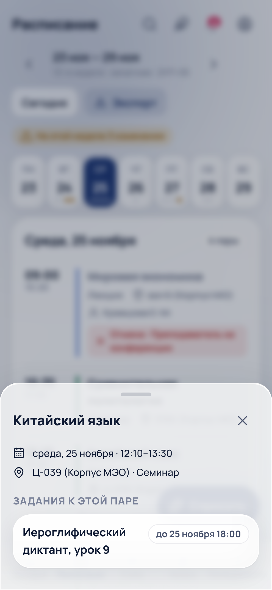

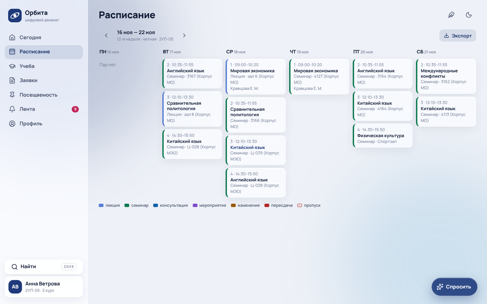

**3. Успеваемость.** Для каждой дисциплины виден рейтинг из 100 и из чего он складывается:
- срезы 1–3 (вес 1);
- посещаемость в процентах посещенных пар (вес 0,5);
- работа на парах (вес 0,3).

Рядом показан средний балл группы и статус: «Автомат» (для зачета от 70 баллов), «Допуск к экзамену» (от 50) или «Нужно внимание». Сверху — компактная шкала оценивания: баллы, буква ECTS и оценка. Во вкладке «Сессия» — даты зачетов и экзаменов с консультациями, во вкладке «Зачетка» — оценки прошлых семестров и средний балл. Объем дисциплины пишется полностью, например «5 зачетных единиц», а при наведении видно количество академических часов.

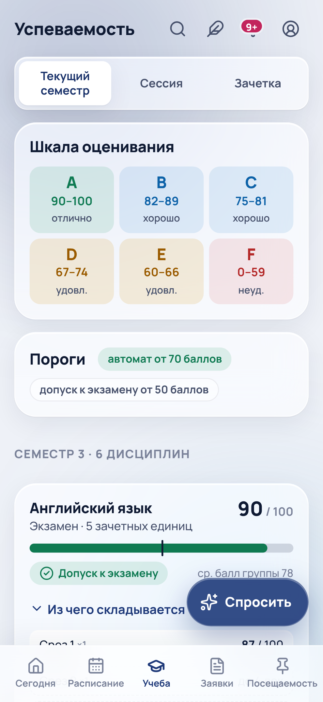  

**4. Заявки и справки.** Каталог из 7 услуг:
- справка об обучении;
- выписка из зачетки;
- справка о размере стипендии;
- ректорская пересдача;
- материальная помощь;
- академический отпуск;
- вопрос в деканат (ответ за 1 рабочий день).

Форма проверяет поля и сразу подсказывает ошибки, а черновик не пропадает при закрытии. Статус показан шкалой «Принята → В работе → Готово», у каждой заявки есть плановый срок и переписка с деканатом. Если деканату нужно уточнение, заявка переходит в статус «Нужно уточнение», а после ответа студента возвращается в работу.

Электронная справка об обучении готова сразу. Это PDF с номером, подписью сотрудника, штампом электронной подписи и QR-кодом. Код ведет на страницу проверки подлинности, где ФИО скрыто частично. Для заявлений (матпомощь, академический отпуск, ректорская пересдача) собирается типовое заявление в PDF: шапка «Декану… от студентки…», текст, приложения, дата и подпись. Род и падежи ФИО учитываются по полу: «Дана Ветровой Анне Сергеевне… является студенткой», «от студента Северцева Тимура Андреевича».

 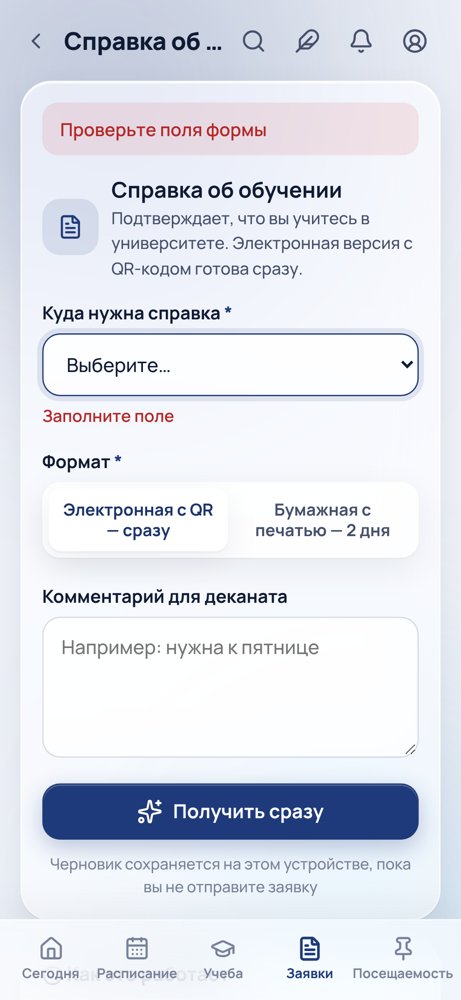 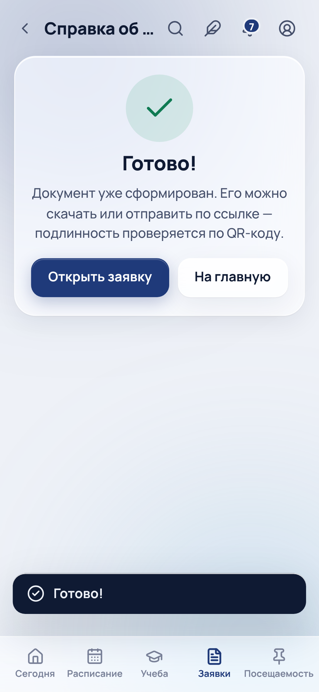

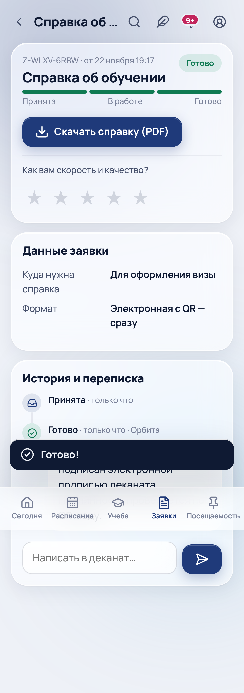  

**5. Уведомления.** Лента собирает:
- объявления деканата (для всех, факультета или группы);
- изменения расписания;
- смены статусов заявок;
- мероприятия;
- автоматические напоминания о дедлайнах за 48 часов.

Есть фильтры по типам и кнопка «Прочитать все». Важные сообщения отмечены, число непрочитанных показано на значке в меню. Кнопка «Перейти» ведет точно к месту: дедлайн открывает пару, на которой задали задание, а изменение открывает нужную неделю расписания.

  

### 3.2 Главный экран «Сегодня»

Показывает приветствие и неделю (номер и четность) и собирает в одном месте:
- баннер о пересдаче;
- изменения в расписании;
- текущую или следующую пару;
- быстрые действия «Справка», «Выписка», «Мои баллы», «Вопрос деканату»;
- пары на сегодня;
- дедлайны;
- пропуски;
- заявки;
- новости;
- стипендию (только у бюджетников, просто как факт).

  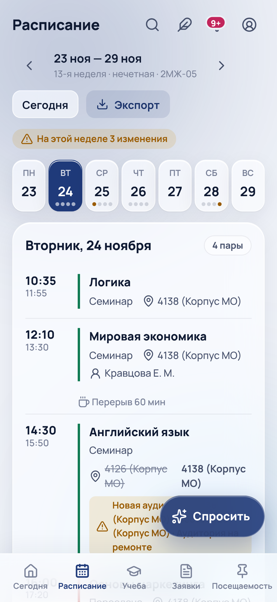

### 3.3 Свои идеи

- **Посещаемость и проходы.** Пропуски считаются в академических часах: пара — 2 ак. ч. Показывается «N ак. ч. из 30 ак. ч.», а после 30 — «из 60 ак. ч.» с пометкой «риск отчисления». Пропуски по справке не учитываются. Во вкладке «Входы и выходы» видно, когда студент пришел в университет и ушел и сколько часов провел там за день и за неделю (данные турникетов, СКУД).
- **Мероприятия.** Конференции, открытые лекции и мастер-классы публикуют деканат и преподаватели. Мероприятие можно добавить в свой календарь прямо из ленты. Если оно пересекается с парами, кабинет предупредит и предложит добавить «все равно». В расписании пересекающиеся события стоят рядом со сдвигом, как в календаре.
- **Кабинет преподавателя.** В нем:
  - расписание по своим группам;
  - отметка отсутствующих (пропуск сразу виден студенту и влияет на рейтинг);
  - задания со сроком «к следующей паре» или к своей дате;
  - сводка посещаемости;
  - публикация мероприятий;
  - заявка на перенос пары, которую согласует деканат.
- **Кабинет деканата.** В нем:
  - очередь заявок с просрочками и смена статусов (причина отказа обязательна);
  - переписка со студентом;
  - объявления и мероприятия;
  - изменения расписания: пару можно поставить в любое время, а при пересечении с другой парой появится ошибка;
  - назначение пересдач;
  - согласование переносов (значок показывает, сколько ждут решения);
  - посещаемость и проходы по каждому студенту.
- **Облегченная версия `/lite`.** Страницы собираются на сервере, без JavaScript и анимаций. В ней работают все три роли: студент подает заявки и отвечает на уточнения, деканат меняет статусы и согласует переносы, преподаватель отмечает посещаемость. Если основной кабинет грузится дольше 4 секунд или браузер сообщает о медленной сети, кабинет сам предложит перейти в облегченную версию. Кнопка с пером есть в шапке рядом со сменой темы.
- **Помощник «Спроси Орбиту».** Отвечает на вопросы по данным студента: «что у меня завтра?», «как дела с допуском к экзаменам?», «как подать на матпомощь?», «сколько у меня пропусков?». К ответу помощник предлагает кнопку действия, например перейти к услуге или открыть успеваемость. Без ключа ИИ он работает на встроенных правилах, с ключом Claude API отвечает через ИИ. ФИО и контакты в ИИ не передаются.
- **Поиск по Ctrl+K**, установка на телефон как приложение (PWA), темная тема.

  

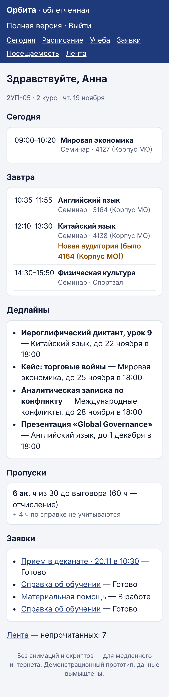 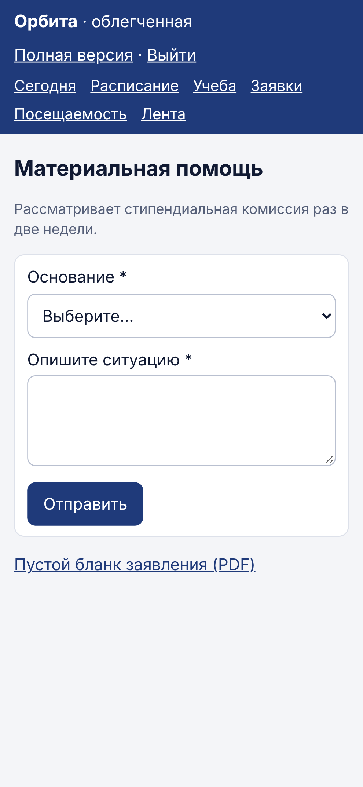 

**Кабинет деканата и преподавателя (компьютер):**

 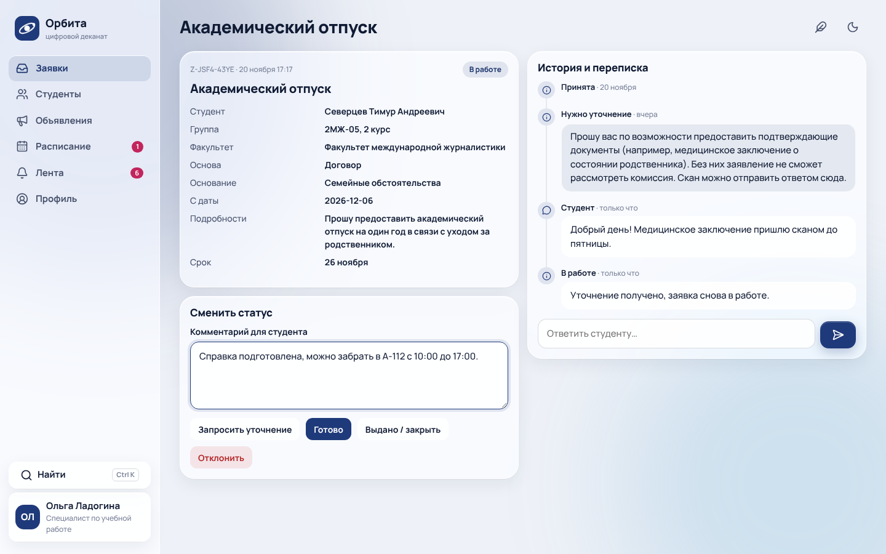

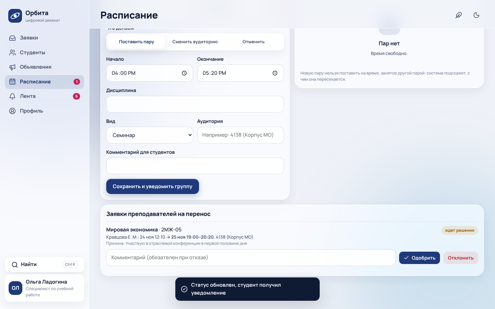 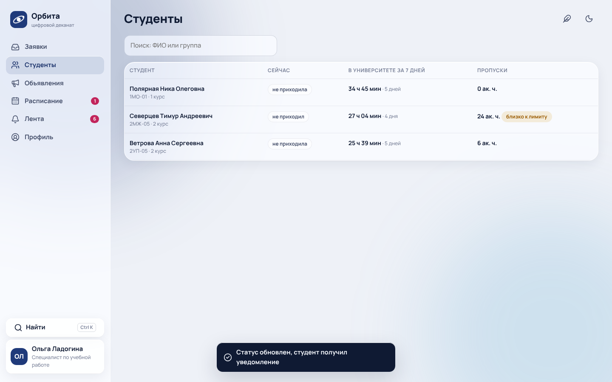

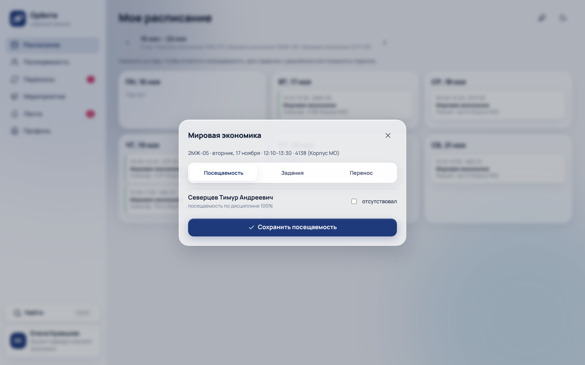 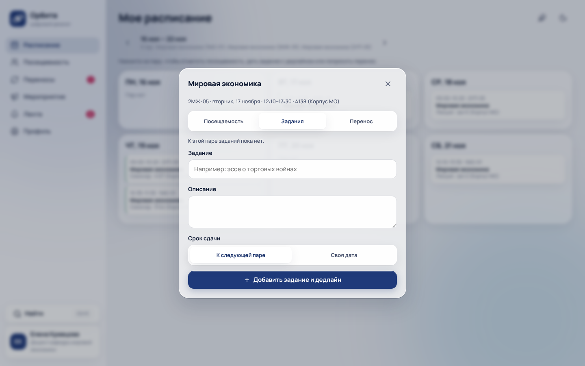

### 3.4 Пустые состояния, ошибки и загрузка

- **Первокурсница Ника.** Еще не сдавала сессию и не подавала заявок, поэтому видит не пустые таблицы, а пояснения: «Зачетка пока пустая — оценки появятся после первой сессии».
- **Чужая заявка.** Если подставить в адрес номер чужой заявки, откроется «Ничего не найдено», без подробностей.
- **Ошибки форм.** Подсвечиваются у конкретного поля.
- **Загрузка.** Пока данные грузятся, показывается каркас страницы. При медленной сети кабинет предлагает облегченную версию.

  

## 4. ИИ-инструменты, IDE и сервисы

| Инструмент | Для чего использован |
| --- | --- |
| **Claude Code** (Anthropic), облачные сессии в браузере на claude.ai/code | Основной ИИ-агент, весь код написан им. Он спроектировал устройство приложения и базы данных, написал сервер, интерфейс, дизайн, тексты интерфейса, вымышленные данные, автотесты и сценарий проверки в браузере. По скриншотам он сам находил и исправлял ошибки верстки. Он вел репозиторий: ветка, проверка и пулл-реквест на каждую итерацию. Написал README, CLAUDE.md, инструкцию по развертыванию и этот документ |
| Claude Code, отдельная сессия для сервера | Помогал автору шаг за шагом развернуть кабинет на своем сервере. Давал команды небольшими блоками, разбирал вывод, нашел и исправил ошибку в службе ночного сброса. Итог сессии он записал в файл для следующего агента (`docs/SERVER-NOTES.md`) |
| Навык Claude Code `claude-api` | Справочник по Claude API. Агент загрузил его перед тем, как писать помощника «Спроси Орбиту», чтобы правильно вызвать модель и настроить запасной вариант |
| Claude API | Работает внутри продукта: помощник отвечает на вопросы студента. Подключается по ключу на сервере. Без ключа помощник работает на встроенных правилах, и сейчас на сервере он работает именно так |
| Playwright + Chromium | Не ИИ, а инструмент агента. Прогоняет сценарии в браузере на ширине 360 и 1440 px и снимает скриншоты. По ним агент проверял верстку, а автор — результат |
| GitHub | Хранение кода, 18 пулл-реквестов — по одному на итерацию |
| Render.com | Первый хостинг для показа (18–22 ноября) |
| VPS Aeza (Москва), Caddy, Let's Encrypt, DuckDNS | Боевой хостинг: сайт открывается из России без VPN, по HTTPS |
| Открытые материалы | Шрифт Manrope (OFL), иконки Lucide (ISC), шрифт Liberation Serif для PDF (OFL), библиотеки Express, pdfkit, qrcode (MIT) |

Отдельная среда разработки (IDE) не понадобилась: агент работал в облачной сессии, а автор смотрел результат в браузере и на телефоне.

## 5. Как шла работа с ИИ: этапы и ключевые промпты

### 5.1 Подход

1. **Первый промпт — полный текст положения конкурса.** Агенту дали цели, обязательное ядро, требования и критерии без пересказа. Так ни одно требование не потерялось.
2. **Дальше — короткие итерации.** Автор открывал сайт, смотрел его с компьютера и телефона, делал скриншоты и присылал список правок одним сообщением, часто нумерованным. На один такой список уходила одна итерация.
3. **Агент не сдавал работу без проверки.** Перед каждой сдачей он запускал 21 автотест и прогон всех сценариев в браузере, а потом сам смотрел скриншоты. Только после этого делался пулл-реквест и слияние.
4. **Правила — в файлах, а не в памяти.** Все договоренности агент записывал в `CLAUDE.md`, чтобы не нарушить их в следующих итерациях: например, «без буквы ё», «чужое → 404», «без градиентов».

### 5.2 Этапы и ключевые промпты

| Дата | Этап | Промпт автора (дословно, сокращенно) | Что сделал ИИ |
| --- | --- | --- | --- |
| 18.11 | Первая версия | Полный текст положения конкурса «Цифровой деканат будущего» | Устройство приложения, база, безопасность, 3 студента и сотрудник, 9 экранов студента, кабинет деканата, тесты, скриншоты, README |
| 18.11 | Дизайн и правила вуза | «убери градиент, сделай дизайн типа liquid glass, акцент… navy blue (по дефолту)… в заявках "пересдача" убрать, заменить на "ректорская пересдача"… сделай рубрику "пропуски"… 30 академических часов… 60 часов — отчисление… раздел, где будут входы и выходы из университета, типа СКУД» | Стиль «жидкое стекло», выбор темы и цвета, раздел «Посещаемость», СКУД, пересдачи от деканата |
| 18.11 | Вход и мелочи | «вход с логином и паролем поставь на центр, добавь анимацию… liquid glass на фон… волнообразно… логотип орбиты должен меняться в цвет выбранного в настройках цвета» | Центрированный вход с медленными «волнами» стекла, логотип в цвет акцента |
| 19.11 | Реалии вуза | «шкалу соответствия оценок я приложил, адаптируй оценки… расписание приведи в соответствие с парами… факультеты должны быть следующие… ФИО преподов исключай… нужно чтобы была кнопка облегченной версии… в случае если сайт грузит медленно» | Шкала ECTS, время пар, 8 факультетов, расписание групп по открытым данным, облегченная версия `/lite` с автопредложением |
| 19.11 | Рейтинг | «контрольные точки должны быть "срез 1", "срез 2" и "срез 3"… посещаемость… % от посещенных пар… удельная оценка за срезы… 1, посещаемость 0,5, работа на паре 0.3… от 70 баллов за зачет = автомат» | Новая формула рейтинга, автомат, счетчик пропусков «из 30 / из 60» |
| 19.11 | Деканат | «дай возможность сотруднику деканата ставить самостоятельно пары в любое время, предусмотри, чтобы был баннер, если пара становится на время другой пары» | Форма с проверкой пересечений и понятной ошибкой |
| 21.11 | Большая итерация | «в ленте были в том числе события… кнопка "Добавить в календарь"… если оно пересекается с парами… баннер… как в Google календаре… дедлайны должны быть привязаны к парам… кабинет преподавателя… перенос пары… согласует деканат» | Мероприятия, задания к парам, кабинет преподавателя, переносы через деканат, типовые заявления в PDF |
| 22.11 | Облегченная версия для всех | «Облегченная версия должна уметь принимать заявки, отклонять, запрашивать доп. требования… для преподавателей и сотрудников деканатов и студентов» | Работа с заявками и переносами в `/lite` для трех ролей |
| 22.11 | Понятность | «я не понимаю, что значит этот раздел» → «давай уберем этот раздел, он запутывает совсем» | Убран блок «Нужно на экзамене», шкала оценивания переделана в наглядные плашки |
| 22.11 | Логика переходов | «"Перейти"… вводит обратно на страницу сегодня… Я предлагаю, чтобы он переходил на страницу… самой пары… на которой задали… задание» | Дедлайн ведет на пару, два вида сроков: «к следующей паре» и своя дата |
| 22.11 | Проверка честности цифр | «на главном экране написано "в расписании 4 изменения", открываю расписание, там три изменения, что не так? надо перепроверить работу» | Найдена и исправлена ошибка подсчета (раздел 7) |
| 22.11 | Документы | «справки должны генерироваться С УЧЕТОМ пола… выдавать деньги за сломанный ноутбук в университете не предусмотрено» | Склонение ФИО по падежам и роду, справка в PDF, реальные основания матпомощи |
| 22.11 | Свой сервер | «помоги мне перенести это все на свой личный сервер… 1 ядро, 2 GB… сделай полноценный туториал» | Инструкция `docs/DEPLOY.md`, конфиги служб и веб-сервера, затем пошаговое развертывание с автором |

Подробный журнал всех итераций с промптами и тем, что сделано по каждому пункту, — в Приложении.

### 5.3 Решения, которые агент принял сам и закрепил в правилах

- **«Личность — только из сессии».** Номер студента никогда не берется из адреса или формы. Чужой объект отдает ответ «не найдено», а не «запрещено», чтобы не выдать, что он существует.
- **«Форма услуги описана на сервере».** И сайт, и сервер берут поля из одного каталога. Новая услуга добавляется одной записью.
- **«В ИИ уходит сводка без ФИО, контактов и номера зачетки».**
- **«Если ключа ИИ нет, помощник не ломается»** и отвечает по встроенным правилам.
- **«Демо-данные считаются от сегодняшнего дня»**, чтобы кабинет в любой день выглядел живым.

## 6. Файлы для ИИ-агентов

Проект устроен так, чтобы следующий агент или человек продолжил работу без потери контекста.

| Файл | Что в нем |
| --- | --- |
| `CLAUDE.md` | Инструкция для ИИ-агентов, ее читают перед любыми правками. В ней: стек, где что лежит, 9 непреложных правил (безопасность, вымышленные данные, стиль текстов, без градиентов, проверка на ширине 360 px), порядок проверки перед коммитом, рецепт «как добавить услугу» |
| `test/security.test.js` | 21 автотест — исполняемая спецификация. Если агент случайно нарушит разделение данных или защиту, тест упадет |
| `scripts/screenshots.js` | Сквозной прогон всех ролей в браузере на телефоне и компьютере. Одновременно проверяет сценарии и обновляет скриншоты для документации |
| `docs/DEPLOY.md` | Пошаговая инструкция развертывания на своем сервере |
| `docs/SERVER-NOTES.md` | Передача дел между ИИ-сессиями: что сделано на сервере, найденные проблемы, что осталось. Без секретов |
| `server/catalog.js` | Каталог услуг: одна запись — форма, проверка полей и статусы |

## 7. Ошибки ИИ и как они исправлялись

ИИ ошибался, и это нормально. Важно, как ошибки находились. Часть нашел сам агент по автотестам и скриншотам, часть — автор, когда смотрел сайт как студент.

| Что пошло не так | Кто и как заметил | Как исправлено |
| --- | --- | --- |
| Лента на телефоне шире экрана (587 px при ширине 360 px) | Агент: автопроверка ширины в браузере | Элементам сетки разрешено сжиматься |
| Кнопка «Спросить» перекрывала кнопку отправки формы | Агент: скриншот формы | На формах кнопка скрывается |
| В справке «очная формы», «факультетаа» | Агент: скриншот справки | Функция склонения названий |
| Тесты мешали друг другу: блокировка после 5 ошибок входа отключала аккаунт для следующего теста | Агент: упал `npm test` | Тест блокировки перенесен в конец |
| В темной теме не было видно цвет лекций в расписании | Автор: «цвет лекции не виден… надо протестить, чтобы все цвета были видны» | Цвета сетки заданы явно для обеих тем |
| Чип «важно» в темной теме сливался с фоном | Автор: скриншот ленты | Отдельный цвет для чипа |
| Пересекающиеся события стояли узкими колонками, и текст налезал | Агент: скриншот | События стоят стопкой со сдвигом |
| Квадратик «мероприятие» в легенде был больше остальных | Автор: скриншот с телефона | Совпадали названия стилей, стиль переименован |
| Задания в демо-данных были «заданы» на будущих парах | Агент: проверка данных | Задание ищет пару только в прошлом |
| На главной «4 изменения», а в расписании 3 | Автор | Главная считала изменением мероприятие из личного календаря и брала 8 дней вместо недели. Теперь обе страницы считают одинаково |
| «Прочитать все» не отмечало напоминания о дедлайнах | Автор | Отметка о прочтении напоминаний сохраняется |
| Пример матпомощи «за сломанный ноутбук» не соответствовал правилам вуза | Автор: «выдавать деньги за сломанный ноутбук не предусмотрено» | Основания приведены к реальным: потеря кормильца, лечение и т. д. |
| В документах «студентом(кой)», «он(а)» | Автор: «справки должны генерироваться с учетом пола» | Поле «пол» и склонение ФИО по падежам |
| На сервере ночной сброс останавливал сайт и не включал обратно | ИИ-агент на сервере: служба упала, сайт выключен | Служба переписана: сайт включается обратно при любом исходе. Исправление внесено в репозиторий |

**До исправлений:**

 

## 8. Скриншоты: от первой версии к готовому кабинету

Как менялся кабинет за 5 дней:
1. **Первая версия (18.11)** — градиенты и фиолетовый акцент.
2. **«Жидкое стекло» (18.11)** — полупрозрачные панели и navy.
3. **После правок по правилам вуза (22.11)** — срезы, посещаемость, работа на парах.
4. **Финал** — шкала оценивания и компактные пороги.

**Удачные решения:** «жидкое стекло» без градиентов и главный экран, который сам отвечает «что сейчас».

**Неудачные варианты, от которых отказались:**
- прогноз «сколько нужно на экзамене» запутывал;
- шкала оценок полосой с цифрами была непонятной;
- вертикальная таблица шкалы занимала пол-экрана.

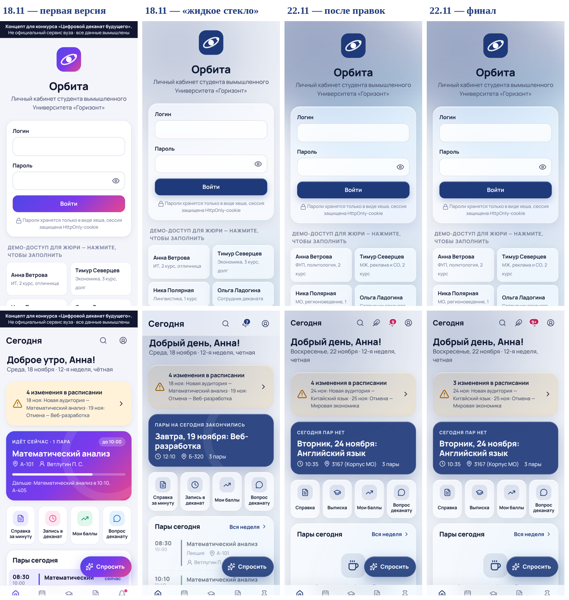

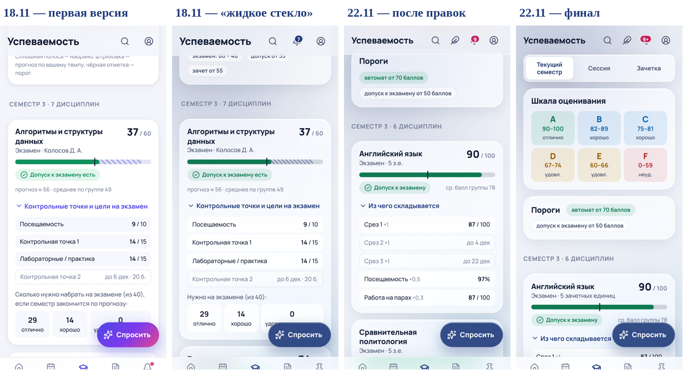

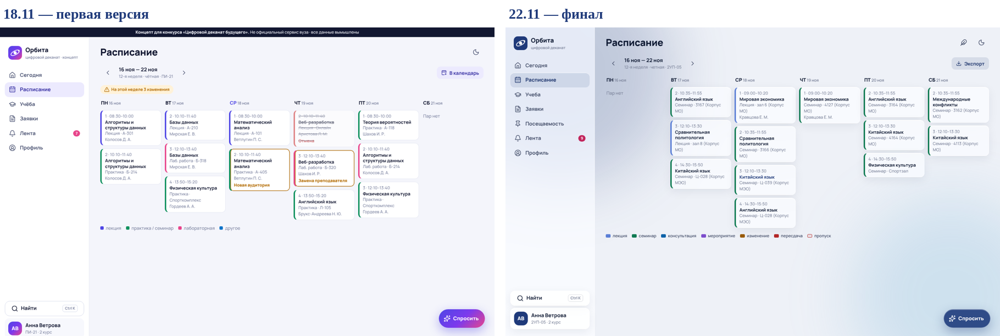

**Готовый кабинет на компьютере:**

 

## 9. Как устроены вход, хранение данных и защита

Простыми словами:

- **Пароли.** На сервере хранится не сам пароль, а его «отпечаток» (scrypt с солью). Восстановить пароль по отпечатку практически невозможно. После 5 неверных попыток вход блокируется на 10 минут.
- **Сессия.** После входа браузер получает случайный «пропуск» в cookie:
  - JavaScript на странице его прочитать не может;
  - с чужого сайта он не отправится;
  - по сети он передается только по HTTPS.

  В базе хранится только отпечаток пропуска, поэтому даже копия базы не дает войти.
- **Каждый видит только свое.** Сервер не верит номеру студента из адреса или формы. Он всегда берет студента из сессии и ищет заявку с условием «принадлежит этому студенту». Если подставить чужой номер, ответ будет «не найдено». Номера заявок случайные (`Z-7K3Q-9ABX`), их не угадать. Преподаватель видит только свои группы и пары, студент не может открыть кабинет деканата.
- **Персональные данные.** Номер зачетки, телефон, e-mail и дата рождения хранятся в базе зашифрованными (AES-256). Ключ задается в настройках сервера, а не в коде. В профиле эти поля скрыты, пока студент сам их не откроет.
- **Ключи сервисов.** Ключ шифрования и ключ ИИ лежат только в настройках сервера (`/etc/orbita.env`). В коде и в браузере их нет.
- **ИИ.** Помощник получает учебные данные без ФИО и контактов. Действует лимит вопросов.
- **Защита от атак.** Сервер:
  - отклоняет запросы с чужих сайтов (CSRF);
  - запрещает встраивать сайт в чужие страницы;
  - не выполняет посторонние скрипты (CSP);
  - экранирует любой текст.
- **Журнал.** Входы, неудачные попытки и действия сотрудников записываются.
- **Справки.** Подлинность проверяется по QR-коду на открытой странице. Там видно ФИО частично, курс и номер документа, без оценок и контактов.

Все это проверяют автотесты (`npm test`, 21 тест), в том числе:
- пароли хранятся только как хеш;
- поля зашифрованы;
- без входа данные недоступны;
- на чужую заявку и документ отвечает 404;
- студент не попадает в кабинет деканата;
- работает защита от CSRF;
- вход блокируется после 5 неверных попыток.

## 10. Где работает прототип и как он масштабируется

**Хостинг.** Собственный VPS в дата-центре в Москве (1 ядро, 2 ГБ памяти), поэтому сайт открывается из России без VPN. Устройство сервера:
- **HTTPS** — веб-сервер Caddy с бесплатным сертификатом Let's Encrypt, он продлевается сам;
- **приложение** работает как системная служба: само поднимается после сбоя или перезагрузки;
- **демо-данные** пересоздаются каждую ночь;
- **два адреса**: домен и запасной адрес по IP, тоже с HTTPS.

Сайт будет доступен до объявления итогов 28 ноября.

**Стек.**
- **Сервер:** Node.js 22 и Express.
- **База данных:** SQLite, один файл, отдельный сервер базы не нужен.
- **Интерфейс:** современный JavaScript без сборки.

Кабинет быстро открывается и на слабом телефоне: страницы легкие, есть облегченная версия.

**Масштабирование.** Сервер не хранит состояние в памяти: сессии и данные лежат в базе. Поэтому рост нагрузки решается обычными шагами:
1. **Сотни пользователей** — текущий сервер (SQLite в режиме WAL держит сотни запросов в секунду).
2. **Тысячи пользователей** — база переносится на PostgreSQL: запросы простые, без особенностей SQLite. Запускается несколько копий приложения за балансировщиком.
3. **Вуз целиком** — подключение к реальным системам вуза (расписание, оценки, СКУД) через отдельный слой интеграции вместо демо-данных. Каталог услуг уже настраивается одной записью.

## 11. Что сделано вручную

- **Идея и постановка задач.** Автор выбирал, что должно быть в кабинете, ставил задачи агенту и принимал решения по каждой спорной детали: формулировки, цвета, что убрать.
- **Правила вуза.** Шкала оценок, время пар, список факультетов, формула рейтинга, лимиты пропусков, порядок пересдач и материальной помощи — это знания автора, их агент сам взять не мог.
- **Открытые данные.** Автор нашел и передал агенту опубликованное расписание трех групп.
- **Проверка результата.** После каждой итерации автор проходил сценарии как студент, преподаватель и сотрудник деканата, с компьютера и телефона. Найденное он присылал скриншотами со своими пометками.
- **Тексты.** Автор вычитывал формулировки интерфейса и документов и требовал простого и нейтрального языка.
- **Сервер.** Автор купил VPS, настроил DNS (DuckDNS) и выполнил на сервере все команды развертывания. Агент на сервер доступа не имел: он давал команды, а автор присылал их вывод.
- **Отправка работы.** Сборка материалов и отправка в личном кабинете участника.

## 12. Как работа отвечает требованиям конкурса

| Требование | Как выполнено |
| --- | --- |
| Работающий прототип, а не макет | Открывается по ссылке: вход, расписание, оценки, подача заявки и ее статус работают на настоящем сервере с базой данных |
| Обязательное ядро: вход и профиль, расписание, успеваемость, заявки и справки, уведомления | Все 5 разделов реализованы (раздел 3.1) |
| Стек адекватен задаче и масштабируется | Node.js + SQLite, путь роста до PostgreSQL и нескольких копий (раздел 10) |
| Код пишут ИИ-ассистенты | Весь код написан Claude Code, автор ставил задачи и проверял (разделы 4, 5, 11) |
| Мобильная версия от 360 px | Все сценарии проверяются в браузере на ширине 360 px, без горизонтальной прокрутки |
| Только вымышленные данные | Вымышленный университет «Горизонт», студенты и преподаватели. Из открытого расписания ФИО преподавателей убраны |
| Не выдавать за официальный сервис | Пометка на странице входа, в профиле, на странице проверки справки и водяной знак на справках |
| Без логотипа вуза | Свой логотип «Орбита» — орбита вокруг точки, перекрашивается в цвет акцента |
| Лицензии сторонних материалов | Шрифты OFL, иконки ISC, библиотеки MIT (раздел 4) |
| Студент видит только свои данные | Проверка по сессии, чужое → 404, случайные номера заявок, автотесты (раздел 9) |
| Пароли не в открытом виде | scrypt с солью (раздел 9) |
| Ключи не в коде и не в браузере | Только в настройках сервера (раздел 9) |
| Доступность из России без VPN до 28 ноября | VPS в Москве, HTTPS, служба с автоперезапуском (раздел 10) |
| Тестовые аккаунты: 2+ студента и сотрудник | 3 студента, преподаватель и сотрудник деканата (раздел 2) |

---

# Приложение. Журнал итераций с промптами

Ниже — подробная запись каждой итерации после первой версии: что попросил автор (цитаты из промптов) и что именно сделал агент.

### Итерация 2: правки автора после первого показа

После того как прототип развернули на Render, автор посмотрел его и дал агенту список правок одним сообщением:

> убери градиент, сделай дизайн типа liquid glass, акцент на элементах интерфейса должен быть цвета navy blue (по дефолту), световую схему можно выбрать… в блоке сессия нужно заменить слово «испытание» на слово «экзамен»… фразу «Баллов уже не хватит» тоже исключить, писать в нейтральном ключе… сделай легенду типа маленький квадратик со штриховкой — прогноз по вашему темпу, визуала больше там, где текст не обязателен… в заявках «пересдача» убрать, заменить на «ректорская пересдача», так как пересдачи у нас деканат и кафедра устанавливают самостоятельно… сделай рубрику «пропуски»: 30 академических часов — выговор, 60 — отчисление… сделай раздел, где будут входы и выходы из университета, типа СКУД… буквы ё убрать из всего текста.

Как агент это реализовал:

| Правка | Что сделано |
| --- | --- |
| Liquid glass, без градиентов, navy | Дизайн-токены переписаны: полупрозрачные панели с размытием (`backdrop-filter`), световой блик по верхней кромке, мягкие пятна фона. Все градиенты заменены сплошным акцентом `--accent` (navy `#1f3a7a`). Логотип и иконки перерисованы. |
| Выбор оформления | В профиле: световая схема (светлая / темная / как в системе) и 6 акцентных цветов, navy по умолчанию. Выбор запоминается на устройстве. |
| Нейтральные формулировки | «Баллов недостаточно», «Нужно еще N б.», чип «Внимание» вместо «Риск»; «Первый экзамен» вместо «Первое испытание». |
| Больше визуала | Текстовые пояснения заменены легендами-образцами (заливка, штриховка, отметка порога) и цветной шкалой оценок 0–55–70–85. |
| Пересдачи | Услуга «Пересдача» удалена, добавлена «Ректорская пересдача». Пересдачи назначает деканат (новая форма в кабинете сотрудника), они попадают в расписание студента, баннером на главную и уведомлением в ленту. |
| Пропуски | Новый блок на главной и раздел «Посещаемость»: пара = 2 ак. ч., шкала с порогами 30 ч (выговор) и 60 ч (отчисление), пропуски по справке не учитываются. |
| СКУД | Входы и выходы через турникеты: время внутри по дням (полоса дня 7:00–21:00), столбики за неделю, список проходов. Сотрудник видит таблицу студентов («сейчас внутри», часы за неделю, пропуски) и карточку каждого. |
| Буква «ё» | Заменена во всех текстах кода и документации (162 вхождения). |
| Пометка «концепт» | Баннер и подпись убраны. Короткая пометка «Демонстрационный прототип · данные вымышлены» оставлена на странице входа и водяным знаком на справках — этого требует положение конкурса. |

Добавлены 2 автотеста: студент видит только свои пропуски, проходы и пересдачи, а данные всех студентов доступны только деканату; обычной пересдачи в каталоге нет, ректорская есть.

  

### Итерация 3

> «кампус» замени на «посещаемость»; если человек учится по договору, то не надо писать про стипендию; там есть странная линия под баннером; информационный блок «Весь деканат — в одном экране» убери совсем, вход поставь по центру, добавь анимацию liquid glass на фон, чтобы что-то медленно двигалось волнообразно; кнопку «в календарь» замени на «экспорт»; «справка за минуту» — на «справка»; логотип должен меняться в цвет выбранного акцента.

| Правка | Что сделано |
| --- | --- |
| «Посещаемость» | Раздел переименован в меню, заголовке, поиске и ответах помощника. |
| Стипендия по договору | Для обучающихся по договору блок стипендии не показывается нигде: ни на главной, ни в успеваемости, ни в профиле. Для бюджета — нейтрально: «Есть основания», «Пока нет оснований». |
| Линия под шапкой | Причина: у шапки был полупрозрачный фон, и его нижний край был виден на фоне. Теперь шапка прозрачна и получает «стекло» только при прокрутке. Декоративное кольцо на карточке «Сейчас» тоже убрано. |
| Вход | Информационный блок удален, форма по центру. На фоне медленно плывут размытые полупрозрачные волны (CSS-анимация 26–44 с, выключается при «уменьшить движение» в системе). |
| Кнопки | «Экспорт» в расписании, «Справка» на главной. |
| Логотип | Рисуется прямо в разметке и берет цвет из `--fill`, поэтому меняется вместе с акцентом; иконка вкладки браузера тоже. |

 

### Итерация 4: реалии вуза и облегченная версия

Автор прислал шкалу соответствия оценок, таблицу времени пар, список факультетов и три текстовых файла с расписанием групп, а также попросил кнопку облегченной версии на случай, если сайт висит.

| Правка | Что сделано |
| --- | --- |
| Расписание из файлов | Агент написал разборщик: определил дни по порядку пар и меткам «пт»/«сб», оставил общую группу, поток и одну языковую подгруппу, убрал ФИО преподавателей, переименовал физкультуру. Получилось `server/schedule-data.js` для групп 2УП-05 (ФУП, 2 курс), 1МО-01 (МО, 1 курс), 2МЖ-05 (МЖ, 2 курс). |
| Время пар | Две сетки: МО, ФУП, МЖ — обед после 3-й пары; МЭО, МП, МБ, ИМТУР — после 2-й. Восемь пар до 21:50. |
| Шкала оценок | Рейтинг в процентах → 5-балльная оценка и ECTS (A–F). Зачет с 60 баллов. В зачетке и выписке рядом с оценкой стоят баллы и буква ECTS. |
| Факультеты | Демо-студенты переведены на ФУП (политология), МЖ (реклама и связи с общественностью) и МО (зарубежное регионоведение); справочник всех факультетов — в `academic.js`. |
| Облегченная версия | `/lite`: серверные страницы без скриптов, анимаций и шрифтов (сегодня, расписание, учеба, заявки, посещаемость, лента). Вход формой, защита от подделки форм по Origin. Предложение перейти появляется автоматически при медленной загрузке; постоянная кнопка — в шапке рядом со сменой темы. |
| «можно сразу» | Везде просто «сразу». |

Добавлены тесты: облегченная версия не пускает без входа, не показывает чужую заявку и отклоняет форму с чужого сайта; шкала оценок дает правильные буквы ECTS; время 3-й пары зависит от факультета.

 

### Итерация 5: правила рейтинга и посещаемости

| Правка | Что сделано |
| --- | --- |
| Демо-доступ | Подписи карточек входа приведены к новым факультетам. |
| СКУД | Вместо «внутри с …» — «вход в …» и «выход в …». |
| Рейтинг | Вместо контрольных точек — «Срез 1/2/3», «Посещаемость» (% посещенных пар, считается по расписанию и пропускам) и «Работа на парах». Веса: срезы 1, посещаемость 0,5, работа на парах 0,3. Срез 1 заполнен, срезы 2–3 впереди. |
| Зачет | От 70 баллов — автомат, ниже — выход на зачет. |
| Цвета расписания | Пересдача отделена от изменений и выделена красным. Найдена причина невидимого цвета лекций: «стеклянная» рамка перекрывала левую полосу, а для лекций не было отдельного правила. Цвета всех видов занятий заданы явно. |
| Пропуски | «6 ак. ч. из 30 ак. ч.»; после 30 ак. ч. — «36 ак. ч. из 60 ак. ч.» красным с пометкой «риск отчисления». |

### Итерация 6

| Правка | Что сделано |
| --- | --- |
| Пары от деканата | Сотрудник ставит занятие на любое время (начало, конец, дисциплина, вид, аудитория). Если время пересекается с одной или несколькими парами группы, форма показывает ошибку с перечнем пересечений, и занятие не сохраняется. Группа получает уведомление. |
| Шкала пропусков | Убрана лишняя вертикальная отметка в конце шкалы. |
| Правила рейтинга | «Автомат от 70» вынесен в строку «Зачет», допуск и формула — в строку «Экзамен». |
| Карточки дисциплин | «ср. балл группы» вместо «группа», прогноз убран. |
| Выравнивание | Заголовок страницы на широком экране выровнен по левому краю блоков; подзаголовки разделов — тоже. |

### Итерация 7: мероприятия, задания к парам, кабинет преподавателя, PDF-заявления

Автор надиктовал большой список правок голосом; агент разобрал его на задачи:

| Правка | Что сделано |
| --- | --- |
| Метка «важно» | В темной теме текст метки сливался с фоном: переменная акцентного цвета после редизайна стала navy. Розовый цвет вынесен в отдельную переменную, метка читается в обеих темах. |
| Мероприятия | Таблицы `events` и `user_events`. В ленте — карточка мероприятия с кнопками «Добавить в календарь» и «Подробнее», отдельная страница с описанием и файлом .ics. При пересечении с парами — окно «Пересечение с расписанием» со списком пар и кнопкой «Все равно добавить». Создавать мероприятия могут деканат и преподаватель. |
| Пересечения в расписании | Пересекающиеся события объединяются в блок «Пересечение по времени» и встают стопкой со сдвигом. Первая версия ставила их в колонки — на телефоне текст наезжал (скриншот прогона это показал), поэтому выбран вариант со сдвигом. |
| Задания и дедлайны | Дедлайн может быть привязан к паре (`lesson_date`, `lesson_start`) или быть самостоятельным. Пары кликабельны: карточка пары показывает задания; на главной у дедлайна ссылка «к паре …». |
| Кабинет преподавателя | Роль `teacher`, вымышленный преподаватель «Мировой экономики». Расписание по группам, отметка посещаемости (сразу меняет пропуски и рейтинг), задания с дедлайнами, сводка посещаемости, мероприятия, заявки на перенос с проверкой пересечений. |
| Перенос через деканат | Заявка преподавателя падает в «Расписание» деканата; после одобрения у студентов появляется перенос, преподавателю приходит уведомление; отказ — только с причиной. |
| Услуги | Убраны запись на прием, справка в военкомат и индивидуальный график (его нет в вузе). Осталось 7 услуг. Пример «деканат ждет ответа» — академический отпуск с запросом документов. |
| PDF-заявления | Для заявлений (материальная помощь, академический отпуск, ректорская пересдача) — типовое заявление в PDF: шапка справа, текст по данным заявки, строки для дописывания, дата и подпись. Есть и пустой бланк. |

Тесты (20): мероприятие с пересечением требует подтверждения и появляется в расписании; мероприятие другого факультета не открывается; преподаватель не может отметить чужую пару; задание появляется у студента в дедлайнах и в карточке пары; перенос одобряется деканатом и виден группе; PDF-заявление можно получить только по своей заявке.

  

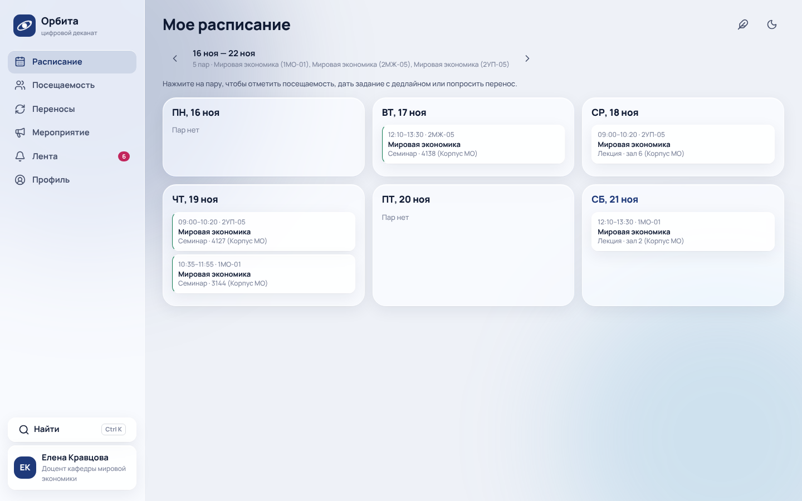

### Итерация 8

| Правка | Что сделано |
| --- | --- |
| Значок о переносах | У деканата на пункте «Расписание» и у преподавателя на «Переносах» — счетчик заявок, ждущих решения. В расписании преподавателя пара с такой заявкой помечена «перенос на согласовании». |
| Облегченная версия работает с заявками | Студент подает заявку по той же схеме формы, отвечает на уточнение, отзывает заявку, скачивает PDF-заявление. Деканат меняет статус (с обязательной причиной для уточнения и отказа), пишет студенту, согласует переносы пар. Преподаватель отмечает посещаемость и просит перенос. Логика вынесена в общий модуль `server/workflows.js` — полная и облегченная версии работают одинаково. |
| Тексты и легенды | Убрана подпись внизу облегченной версии, легенда под шкалой пропусков, пояснения в блоке «Пороги» (остались «автомат от 70 баллов» и «допуск к экзамену от 50 баллов»); «Сегодня проходов в университет не было». |
| Кнопки-иконки | Круглые, без квадратной подсветки при наведении. |

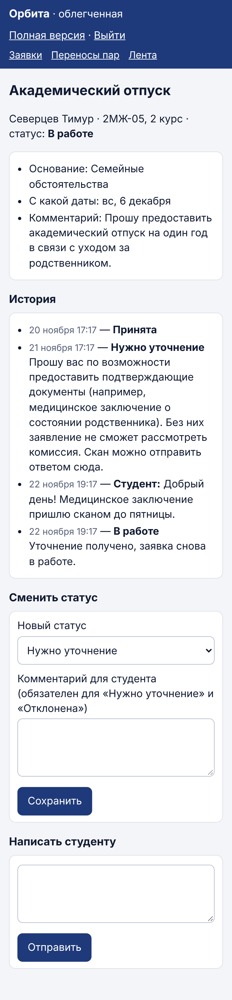 

### Итерация 9

| Правка | Что сделано |
| --- | --- |
| «Нужно на экзамене» | Блок убран из карточек дисциплин — он запутывал. |
| Пропуски в расписании | Пара, на которой студент отсутствовал, подсвечена красным с пометкой «Вы отсутствовали · 2 ак. ч.»; пропуск по справке — синим. В легенде — «пропуск». |
| Шкала оценивания | Вместо полоски с цифрами — таблица «баллы — ECTS — оценка», строки в цвете оценки, цифры по центру. Легенда «рейтинг / автомат / допуск» убрана. |
| Текст справки | «Электронная справка сформирована и подписана» — без слова «автоматически». |

### Итерация 10

| Правка | Что сделано |
| --- | --- |
| «Перейти» у дедлайна | Ведет на пару, на которой задано задание: открывается расписание этого дня и карточка пары (`#/lesson/дата/время`). Раньше вело на главную. |
| Два вида сроков | «К следующей паре» (срок — начало следующей пары по дисциплине) и «своя дата». Преподаватель выбирает вариант при постановке задания; в карточке следующей пары появляется блок «Сдать к этой паре». |
| Легенда расписания | Значок «мероприятие» был больше остальных: класс совпадал с классом элементов истории заявки. Класс переименован. |
| Пересдача | Убрана фраза «заявление не нужно» из уведомлений и ответов помощника. |
| Шкала оценивания | Компактная горизонтальная лента из шести плашек (буква, баллы, оценка); «Пороги» — под ней одной строкой. |
| Выход из всех сеансов | В профиле кнопка «Выйти из всех сеансов»: завершает сеансы на всех устройствах, включая текущее, событие пишется в журнал. |
| «Прочитать все» | Напоминания о дедлайнах раньше не отмечались прочитанными. Теперь отметка сохраняется в отдельной таблице `reminder_reads`. |
| Счетчик изменений | Главная считала мероприятие из личного календаря изменением и брала 8 дней вперед. Теперь считаются только изменения пар до конца недели, баннер открывает нужную неделю, а расписание пишет «До конца недели N изменений». |
| «Как это работает» | Убран пункт «Статус меняется у вас на глазах», остальные пункты сокращены. |
| Материальная помощь | Основания приведены к реальным: потеря кормильца, тяжелое материальное положение семьи, лечение, рождение ребенка, чрезвычайная ситуация, инвалидность. Добавлено поле «Какие документы прилагаете». Пример Анны: потеря кормильца вместо сломанного ноутбука. В заявлении: «Прошу оказать мне материальную помощь в связи с потерей кормильца». |
| Справка об обучении | Генерируется в PDF в том же оформлении, что и заявления: бланк университета, номер, текст, подпись сотрудника, штамп ЭП, QR-код, водяной знак демо. |
| Род и падежи | У пользователей появилось поле «пол» (`users.gender`, для старых записей определяется по отчеству). Модуль `server/grammar.js` склоняет ФИО: «Дана Ветровой Анне Сергеевне», «от студента Северцева Тимура Андреевича», «является студенткой», «Подготовила: О. В. Ладогина». В интерфейсе вместо «отсутствовал(а)» и «не приходил(а)» — форма по полу. |
| Зачетные единицы | «5 з.е.» заменено на «5 зачетных единиц», при наведении видно объем в академических часах. |
| Свой сервер | Инструкция `docs/DEPLOY.md` и конфиги `deploy/` (systemd, Caddy, ночной сброс демо-базы, скрипт обновления). Приложение принимает `HOST`, чтобы слушать только 127.0.0.1 за прокси. |
